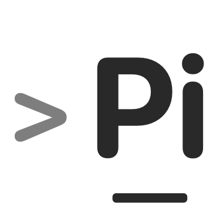

<h1 align="center">
  
  Pi活儿
</h1>

  
  
  

  <a href="docs/readme/README.en.md">English</a>

  <strong>Pi活儿：你说要干什么，Pi 拆开派出去，本机 Worker 接着干。</strong>

  

## 支持的 Agent

内置预设 + **ACP Registry**。Registry 是否可用取决于平台、安装方式（`npx` / `uvx` / binary）及各 Agent 登录。安装包**不内置** Agent CLI。

### 内置预设

| Agent           | 主角色  | 兼角色                  |
| --------------- | ------- | ----------------------- |
| **Claude Code** | coder   | plan, research, general |
| **Codex CLI**   | review  | coder, test, general    |
| **OpenCode**    | general | coder, plan, test       |

### ACP Registry（安装包内目录）

Agoragentic · Amp · Auggie CLI · Autohand Code · Claude Agent · Cline · Codebuddy Code · Codex · Cortex Code · Corust Agent · crow-cli · Cursor · DeepAgents · Devin · DimCode · Dirac · Factory Droid · fast-agent · Gemini CLI · GitHub Copilot · GLM Agent · goose · Grok Build · Harn · Junie · Kilo · Kimi CLI · Minion Code · Mistral Vibe · Nova · OpenCode · pi ACP · Poolside · Qoder CLI · Qwen Code · siGit Code · Stakpak · VT Code

---

## Leader 模型与服务商

在 **设置** 中配置（本地加密）。Leader 使用 `provider/model`。

| 服务商           | 接口类型             | 密钥                                              |
| ---------------- | -------------------- | ------------------------------------------------- |
| OpenAI           | OpenAI               | `OPENAI_API_KEY`                                  |
| Anthropic        | Anthropic Messages   | `ANTHROPIC_API_KEY`                               |
| Google（Gemini） | Google Generative AI | `GOOGLE_GENERATIVE_AI_API_KEY` / `GOOGLE_API_KEY` |
| xAI（Grok）      | OpenAI 兼容          | `XAI_API_KEY`                                     |
| DeepSeek         | OpenAI 兼容          | `DEEPSEEK_API_KEY`                                |

自定义网关：OpenAI / Anthropic / Google 兼容端点，或 Settings 中的 Custom（id + baseURL + key）。

---

## 社区与支持

- **问题与建议：** [Issues](https://github.com/xun404/pihuo-agent/issues)
- **支持项目：** [Star](https://github.com/xun404/pihuo-agent) 本仓库
- **贡献：** [CONTRIBUTING.md](./CONTRIBUTING.md)

---

## 开发

见 [CONTRIBUTING.md](./CONTRIBUTING.md)。

## 许可证

[MIT License](./LICENSE)
