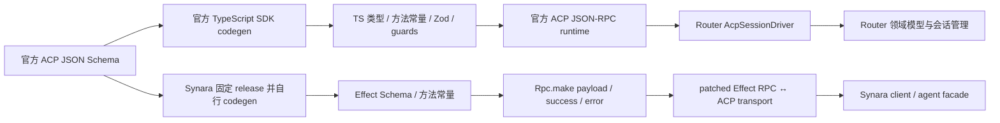

# ACP codegen 与当前实现对比分析

> 日期：2026-07-17  
> 范围：PiHuo 当前 ACP 实现、Synara `effect-acp` codegen 与官方 ACP TypeScript SDK。  
> 性质：仅分析，不包含实现变更。

## 1. 结论摘要

当前 PiHuo 不建议用 Synara 的自建 codegen 替换现有 ACP 实现。

最关键的事实是：PiHuo 当前并不是“手写 ACP 协议”。项目直接使用官方 `@agentclientprotocol/sdk@1.2.1`；这个 SDK 本身已经从官方 JSON Schema 生成 TypeScript 类型、方法常量、Zod 校验器和 extensible-union guards。

因此真正需要比较的不是“手写协议 vs codegen”，而是：

1. **上游 codegen**：消费官方维护的生成结果和 ACP 专用运行时；
2. **下游自建 codegen**：自己固定官方 schema，生成本项目使用的运行时 Schema，并维护 RPC/transport 适配层。

Synara 的主要增益是 schema 版本控制、Effect 原生运行时 codec，以及自定义协议观测和兼容处理；它解决的不是 PiHuo 当前并不存在的“手写 ACP 类型漂移”。

对 PiHuo 更合适的方向是保留官方 SDK，同时补充关键返回值校验、依赖升级契约测试和应用领域防腐层。

## 2. 两条实现链路



两边最终都需要应用层 runtime。Codegen 只负责协议契约和 codec，不能替代以下能力：

- 子进程生命周期；
- initialize 与 capability negotiation；
- session new/load/resume/close；
- session pool 与恢复策略；
- auth、取消、超时；
- 文件系统边界；
- approval 领域映射；
- 流式输出归一化。

所以 Synara codegen 不是 `AcpSessionDriver` 的整体替代品，它最多替换其下方的协议类型、codec 和 transport 部分。

## 3. 当前 Router ACP 的实际构成

`packages/adapters/package.json` 依赖：

```json
"@agentclientprotocol/sdk": "^1.2.1"
```

锁文件当前解析到 `1.2.1`。`packages/adapters/src/acp-session-driver.ts` 直接从 SDK 导入：

- `methods`；
- `PROTOCOL_VERSION`；
- `InitializeResponse`、`PromptResponse` 等协议类型；
- `client`、`ndJsonStream` 等 ACP runtime。

当前项目手写的 `AcpPermissionRequest`、`NormalizedStopReason`、`PromptResult` 等不是对官方协议类型的复制，而是应用领域模型。它们承担协议到产品语义的防腐和收敛，应当继续由应用维护。

例如 `mapPermissionRequest` 在 SDK 已解析协议形状后，进一步强制 approval options 非空、ID 唯一、kind 合法。这属于 PiHuo 的业务安全规则，不应交给协议 codegen。

## 4. 核心差异

| 维度                           | PiHuo 当前方案                  | Synara codegen 方案                          |
| ------------------------------ | ----------------------------------- | -------------------------------------------- |
| 协议真相源                     | 官方 npm SDK                        | 固定的官方 schema release                    |
| 谁维护生成器                   | ACP 官方项目                        | Synara 自己维护                              |
| 生成产物                       | TS 类型、方法常量、Zod、guards      | Effect Schema、方法常量                      |
| RPC 方法绑定                   | 官方 SDK 已封装                     | `rpc.ts` 手工逐方法 `Rpc.make`               |
| 入站 request/notification 校验 | 官方生成 Zod                        | Effect Schema/RPC codec                      |
| agent response 校验            | 高层 API 基本只取 `response.result` | success/error schema 进入 Effect RPC codec   |
| JSON-RPC transport             | ACP 专用实现                        | 通用 Effect RPC 加 ACP patched bridge        |
| JSON-RPC error                 | 原生转换为 `RequestError`           | 需改写成 Effect Cause envelope               |
| 扩展与观测                     | SDK 约定范围内                      | 更易加入自定义 request、日志 stage、错误模型 |
| 升级控制                       | 升 npm SDK                          | 修改 schema pin 并重新生成                   |
| 框架耦合                       | 普通 TS、SDK/Zod                    | Effect Schema、Effect unstable RPC           |
| 维护成本                       | 低                                  | 高                                           |

## 5. 运行时校验差异

### 5.1 官方 SDK 已做的校验

官方 SDK 并非只有编译期类型。其 `AgentApp`/`ClientApp` 注册 handler 时，会在 handler 执行前用生成的 Zod Schema 解析 request 或 notification params。

当前项目最关心的消息包括：

- `session/request_permission`；
- `session/update`；
- `fs/read_text_file`；
- `fs/write_text_file`；
- terminal 请求；
- initialize/session/prompt 等作为服务端时收到的请求。

因此，原分析中“当前 ACP 只有手写类型、wire 输入不受 schema 保护”的判断不成立。

### 5.2 官方 SDK 当前缺失的校验

SDK 发送请求后，JSON-RPC connection 对成功响应的处理基本是：

```ts
pendingResponse.resolve(response.result)
```

除少数空对象归一化或 handle 包装外，没有针对每个方法的 response Zod parse。

这意味着 PiHuo 作为 ACP client 时，以下返回值主要依赖 TypeScript 静态类型和少量应用层检查：

- `InitializeResponse`；
- `NewSessionResponse`；
- `ResumeSessionResponse`；
- `LoadSessionResponse`；
- `PromptResponse`。

当前 driver 会主动验证协商后的 `protocolVersion`，也会归一化 `stopReason`，但不是所有返回字段都有完整运行时 schema 校验。

### 5.3 Synara 的优势

Synara 在 `rpc.ts` 中为每个 RPC 绑定：

```ts
Rpc.make(method, {
  payload: AcpSchema.SomeRequest,
  success: AcpSchema.SomeResponse,
  error: AcpSchema.Error,
})
```

这让请求 payload、成功返回和错误进入同一套 Effect Schema/RPC codec。相对于官方 SDK 高层 API，完整 response codec 是 Synara 最明确、最有实际意义的技术优势。

但这项优势可以通过给少数关键 response 增加针对性校验获得，不必为此复制整套协议生成器和 transport。

## 6. 生成器正确性与兼容语义

协议 codegen 不是简单地把 JSON Schema 转成 TypeScript。

官方 SDK 当前生成器专门处理了：

- `x-deserialize-default-on-error` 一类容错字段；
- required 字段缺失与字段值损坏的不同语义；
- 数组中坏元素的跳过；
- extensible union 的已知 tag 排除；
- 自定义 variant 的额外 payload 保留；
- 原型污染相关键的处理；
- 生成结果与预期 union 数量的 drift assertion。

这些逻辑在生成的 `schema-deserialize.js` 中体现为 `defaultOnError`、`requiredDefaultOnError`、`vecSkipError`、`excludeKnownTags` 和 `preserveCustomPayload`。

Synara 当前生成器主要做：

- 下载固定 release 的 `schema.unstable.json` 和 `meta.unstable.json`；
- 将 nullable type 数组归一化成 `anyOf`；
- 用 `@effect/openapi-generator` 生成 Effect Schema；
- 生成方法常量和协议版本。

它尚未实现与官方当前生成器等价的 extensible-union 和容错反序列化逻辑。由此可推断：Synara 若直接把 pin 升到当前 schema，生成器本身可能先需要适配；不能假设“改一个版本号即可无成本升级”。

这是自建 codegen 最容易被低估的长期成本。

## 7. Transport 的差异

官方 SDK 的 transport 是 ACP 专用 JSON-RPC 实现，直接理解：

- 普通 JSON-RPC result/error；
- `RequestError`；
- request cancellation；
- ACP request/notification method；
- session context；
- stdio、in-process，以及 SDK 提供的其他 transport。

Synara 把 ACP 映射到通用 Effect RPC，因此需要在 `protocol.ts` 做额外兼容：

- 将普通 JSON-RPC error 改写成 Effect Cause envelope；
- 处理 request ID `0` 和字符串 ID；
- 对未跟踪 response 做 drop/log；
- 因 Effect envelope 限制剥离 response 中的 `_meta`；
- 单独路由 notification 和 extension request；
- 处理 process exit、decode failure 与 pending request 收敛。

这些代码同时是优点和成本：

- 优点：Synara 获得了统一 Effect 生命周期、错误通道、日志和扩展机制；
- 成本：必须持续维护 ACP 与通用 RPC 框架之间的阻抗层。

如果 PiHuo 不准备整体迁移到 Effect RPC，这部分复杂度没有足够回报。

## 8. 当前版本快照

截至 2026-07-17：

- PiHuo 锁定的 `@agentclientprotocol/sdk@1.2.1` 是官方最新 TypeScript SDK；
- 官方协议仓库最新 schema artifact 是 `schema-v1.19.0`；
- Synara 当前固定 `v0.11.3`；
- 官方稳定 wire protocol version 仍为 `1`。

schema artifact 版本和 wire protocol version 不是同一概念。两个 schema artifact 即使版本号差异很大，也可能都描述 protocol version 1；wire 兼容性应以 initialize 协商的 `protocolVersion` 和 capabilities 为准。

按当前两个 checkout 的方法常量比较：

| 方法集合       | Synara | 官方 SDK 1.2.1 |
| -------------- | -----: | -------------: |
| Agent methods  |     14 |             28 |
| Client methods |     11 |             14 |

Synara 当前生成结果缺少：

- provider list/set/disable；
- MCP connect/message/disconnect；
- session delete；
- NES；
- document events；
- 新版 elicitation 路径。

同时还保留旧的 `session/set_model`、`session/elicitation` 和 `session/elicitation/complete`。

这个差距说明 schema pin 能提供升级控制，也容易形成版本滞后。它是 Synara 当前 pin 的状态，不是 codegen 的固有缺陷。

## 9. 优缺点总结

### 9.1 官方 SDK 方案

优点：

- 官方承担 schema 生成、协议兼容和 transport 维护；
- 当前版本与方法覆盖更完整；
- 已有编译期类型和关键入站消息的运行时校验；
- 使用 ACP 原生错误、取消和 session 模型；
- 对当前架构侵入小；
- 升级和维护成本低。

缺点：

- agent response 缺少完整运行时 schema parse；
- 生成的完整 Zod Schema 没有作为公共 API 导出；
- 只公开类型、方法常量、少量 guards 和完整 `schema.json`；
- 本项目 manifest 使用 `^1.2.1`，重新解析依赖时可能自动前进；
- 依赖上游 SDK 的发布节奏与取舍。

### 9.2 Synara 自建 codegen 方案

优点：

- schema release 完全受控；
- 升级 diff 可审查、可重复；
- 类型与运行时 codec 同源；
- payload/success/error 都可进入 schema 边界；
- 适合 Effect Schema/RPC 作为全系统契约中心的项目；
- 便于加入自定义扩展、日志和错误模型；
- 适合未来需要跨语言契约或自研 ACP runtime 的场景。

缺点：

- 重复官方 SDK 已经完成的大量工作；
- 生成器正确性成为本项目责任；
- schema 更新可能先破坏生成器；
- 需维护生成脚本、生成产物、RPC 方法表、facade 和 patched transport；
- 强耦合 Effect beta/unstable RPC；
- 自建 pin 容易滞后；
- 通用 RPC 与 ACP wire shape 的兼容代码较多。

## 10. 建议路线

推荐采用“官方 SDK + 契约加固”的混合路线。

### 10.1 保留官方 SDK

不新增一套平行 ACP 类型和 transport，不复制 Synara `effect-acp`。

### 10.2 控制依赖升级

二选一：

- 将 SDK 改为精确版本；
- 保留 semver range，但只通过自动升级 PR 更新锁文件，并强制跑 ACP contract tests。

### 10.3 增加升级契约测试

CI 记录并检查：

- `PROTOCOL_VERSION`；
- agent/client method set；
- initialize/session/prompt 关键 fixture；
- 当前支持的 capabilities 与可选方法。

升级 SDK 时应显式展示方法和 schema 行为变化，而不是把变化隐藏在依赖刷新中。

### 10.4 补关键 response 校验

官方 SDK 已公开：

```text
@agentclientprotocol/sdk/schema/schema.json
```

PiHuo 也已经依赖 Ajv。可以优先对以下返回值做针对性验证：

1. initialize；
2. session new/resume/load；
3. prompt。

可以直接引用官方 schema 的 `$defs`，或建立小型应用边界 schema。无需再生成另一套 TypeScript 协议类型。

运行时严格校验应优先放在安全和状态关键字段，避免无差别严格化破坏 ACP 官方有意提供的容错和扩展语义。

### 10.5 保留领域防腐层

继续手写并测试：

- approval options 的产品级约束；
- stop reason 归一化；
- runtime error codes；
- capability summary；
- session recovery policy；
- UI/runtime event 归一化。

这些不是 ACP schema 的职责。

### 10.6 优先消除实现路径漂移

当前 `acp-session.ts` 的 one-shot 实现和 `acp-session-driver.ts` 的可复用 driver 同时存在。与“是否自建 codegen”相比，这两条运行路径的行为和错误语义漂移更值得优先治理。

## 11. 何时应重新考虑完整自建 codegen

出现以下任一条件时，再评估自建生成层：

- PiHuo 全面迁移 Effect Schema/RPC；
- 需要 TypeScript 之外的跨语言统一契约；
- 官方 SDK 长期缺少所需协议功能或兼容修复；
- 必须对所有 request、response 和 notification 做统一运行时 codec；
- 需要独立发布自研 ACP server/client runtime；
- 多个内部系统必须消费同一固定 schema artifact，而不能直接依赖官方 SDK。

在这些条件出现之前，自建 codegen 的维护成本高于它带来的收益。

## 参考

- PiHuo：`packages/adapters/package.json`
- PiHuo：`packages/adapters/src/acp-session-driver.ts`
- PiHuo：`packages/adapters/src/acp-session.ts`
- Synara：`packages/effect-acp/scripts/generate.ts`
- Synara：`packages/effect-acp/src/rpc.ts`
- Synara：`packages/effect-acp/src/protocol.ts`
- [ACP 官方 TypeScript SDK](https://github.com/agentclientprotocol/typescript-sdk)
- [ACP 官方 schema artifacts 与版本说明](https://github.com/agentclientprotocol/agent-client-protocol#versioning)
