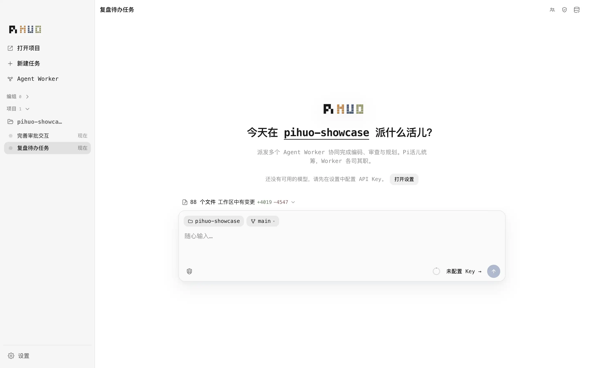

<h1 align="center">
  
  PiHuo
</h1>

  <a href="../../README.md">中文</a>

  <a href="https://github.com/xun404/pihuo-agent/releases/latest">Download</a>

  

PiHuo is a local desktop app. You name the job. The Pi Leader breaks it up and hands it out. Workers on your machine finish it.

The Leader runs on the [Pi coding agent](https://pi.dev/) and only orchestrates. It does not analyze the project, design a solution, or edit files. Workers join the same session through the [Agent Client Protocol](https://agentclientprotocol.com/) and run Agents you have installed locally. Those CLIs are not bundled.

What you get is a command center. The Leader splits the work and chooses who in the current session's Team receives it. Code, commands, and file changes happen on the Worker side. Settings, keys, and sessions stay on this machine. No cloud account is required.

Orchestration and execution stay separate. The Leader dispatches and relays. Workers do the work. You choose who is on the Team. Permission stays with the current session. It is not an OS sandbox.

[MIT License](../../LICENSE)
