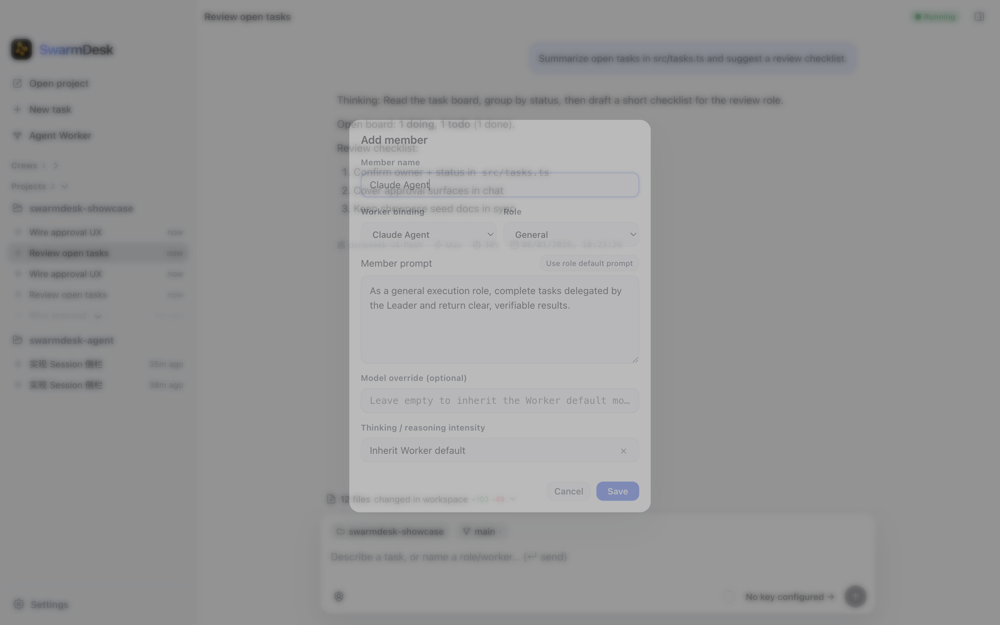

<h1 align="center">
  <a href="https://github.com/xun404/swarmdesk-agent">
    <picture>
      <source media="(prefers-color-scheme: dark)" srcset="../assets/icon_dark.png" />
      
    </picture>
  </a>
  SwarmDesk
</h1>

<p align="center">
  <a href="https://github.com/xun404/swarmdesk-agent/stargazers"></a>
  <a href="https://github.com/xun404/swarmdesk-agent/releases"></a>
  <a href="https://github.com/xun404/swarmdesk-agent/blob/main/LICENSE"></a>
  
</p>

<p align="center">
  <sub><a href="../../README.md">English</a></sub>
</p>

<p align="center">
  <strong>本机多智能体指挥台（ACP）。</strong><br/>
  Mastra Supervisor（Leader）负责规划与委派；Claude Code、Codex、OpenCode 与 Registry Agent 在本地执行，统一在桌面应用中跟踪。
</p>

<h3 align="center"><a href="https://github.com/xun404/swarmdesk-agent/releases/latest"><ins>下载 SwarmDesk</ins></a></h3>

<p align="center">
  
</p>

## 功能

<table>
<tr>
<td width="50%" valign="middle">

### Leader 对话与委派

与 Supervisor Leader 对话；按角色（`plan` · `coder` · `review` · `test` · `research` · `general`）把任务派给合适的 ACP Worker。

</td>
<td width="50%">
  
</td>
</tr>
<tr>
<td width="50%" valign="middle">

### 实时 Worker 卡片

每个 Job 一张卡片：工具调用、终端输出与终态流式可见，避免重复卡片。

</td>
<td width="50%">
  
</td>
</tr>
<tr>
<td width="50%" valign="middle">

### 可控审批

ACP 权限请求出现在 Chat 与侧栏。Session 策略：手动 / 允许一次·始终 / 拒绝一次·始终。

</td>
<td width="50%">
  
</td>
</tr>
<tr>
<td width="50%" valign="middle">

### ACP Registry

从官方 Registry 发现与准备 Agent（含离线 bundled 快照）。需显式 **准备 → 信任 → 认证**。

</td>
<td width="50%">
  
</td>
</tr>
<tr>
<td width="50%" valign="middle">

### 设置中的模型与密钥

配置 Leader 模型与 API Key，本地加密存储。内置服务商 + OpenAI / Anthropic / Google 兼容网关。

</td>
<td width="50%">
  
</td>
</tr>
<tr>
<td width="50%" valign="middle">

### 项目与会话

打开本地项目路径，多会话管理，标题栏重命名；在 Agent 支持时跨重启恢复 ACP 上下文。

</td>
<td width="50%">
  
</td>
</tr>
</table>

**此外还包括：**

- **i18n** — 标题栏中文 / English
- **Git 与文件** — 真实 `git status` 与有界目录树
- **步骤预算** — 可配置 Leader 最大步数，耗尽后可在同 thread 继续
- **本地优先** — 数据在 `~/.config/swarmdesk-agent/`

---

## 支持的 Agent

内置预设 + **ACP Registry**。Registry 是否可用取决于平台、安装方式（`npx` / `uvx` / binary）及各 Agent 登录。安装包**不内置** Agent CLI。

### 内置预设

| Agent           | 主角色  | 兼角色                  |
| --------------- | ------- | ----------------------- |
| **Claude Code** | coder   | plan, research, general |
| **Codex CLI**   | review  | coder, test, general    |
| **OpenCode**    | general | coder, plan, test       |

### ACP Registry（安装包内目录）

Agoragentic · Amp · Auggie CLI · Autohand Code · Claude Agent · Cline · Codebuddy Code · Codex · Cortex Code · Corust Agent · crow-cli · Cursor · DeepAgents · Devin · DimCode · Dirac · Factory Droid · fast-agent · Gemini CLI · GitHub Copilot · GLM Agent · goose · Grok Build · Harn · Junie · Kilo · Kimi CLI · Minion Code · Mistral Vibe · Nova · OpenCode · pi ACP · Poolside · Qoder CLI · Qwen Code · siGit Code · Stakpak · VT Code

---

## Leader 模型与服务商

在 **设置** 中配置（本地加密）。Leader 使用 Mastra 模型路由（`provider/model`）。

| 服务商           | 接口类型             | 密钥                                              |
| ---------------- | -------------------- | ------------------------------------------------- |
| OpenAI           | OpenAI               | `OPENAI_API_KEY`                                  |
| Anthropic        | Anthropic Messages   | `ANTHROPIC_API_KEY`                               |
| Google（Gemini） | Google Generative AI | `GOOGLE_GENERATIVE_AI_API_KEY` / `GOOGLE_API_KEY` |
| xAI（Grok）      | OpenAI 兼容          | `XAI_API_KEY`                                     |
| DeepSeek         | OpenAI 兼容          | `DEEPSEEK_API_KEY`                                |

自定义网关：OpenAI / Anthropic / Google 兼容端点，或 Settings 中的 Custom（id + baseURL + key）。

---

## 安装

### 桌面 — macOS / Windows / Linux

- **[下载最新 Release](https://github.com/xun404/swarmdesk-agent/releases/latest)**
- 安装包命名：`SwarmDesk-Agent-${version}-…`

| 系统    | 架构                   | 格式          |
| ------- | ---------------------- | ------------- |
| macOS   | Apple Silicon（arm64） | DMG、ZIP      |
| Windows | x64                    | NSIS EXE      |
| Linux   | x64                    | AppImage、DEB |

```bash
# macOS / Linux
shasum -a 256 -c SHA256SUMS

# Windows PowerShell
Get-FileHash .\SwarmDesk-Agent-0.1.0-win-x64.exe -Algorithm SHA256
```

> 当前安装包**未签名 / 未 notarize**。请仅从本仓库 Releases 下载。

**安装后：** 打开应用 → **设置**填写 Leader API Key → 打开项目 → 注册 Worker → 对话。

---

## 社区与支持

- **问题与建议：** [Issues](https://github.com/xun404/swarmdesk-agent/issues)
- **支持项目：** [Star](https://github.com/xun404/swarmdesk-agent) 本仓库
- **贡献 / 交接：** [CONTRIBUTING.md](../../CONTRIBUTING.md) · [HANDOVER](../HANDOVER.md)

本地数据：`~/.config/swarmdesk-agent/`

---

## 开发

见 [CONTRIBUTING.md](../../CONTRIBUTING.md)。

## 许可证

[MIT License](../../LICENSE)
