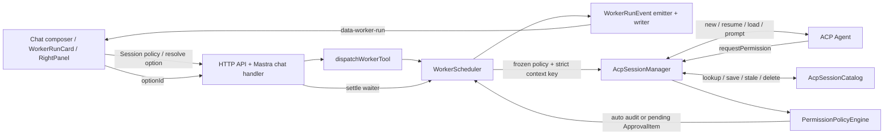
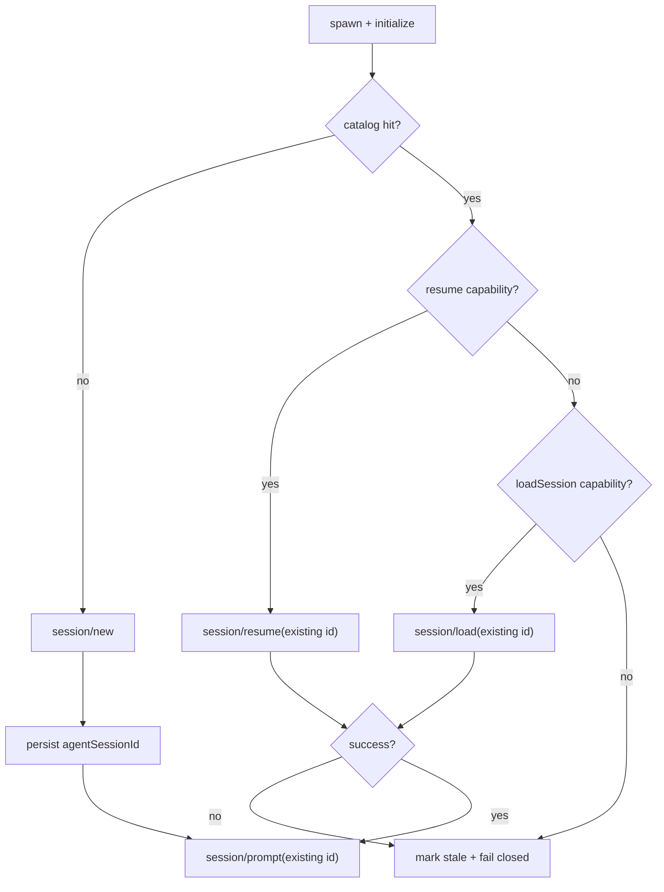

# ACP Worker 卡片、审批闭环与 Session 恢复设计

> 日期：2026-07-14
> 状态：设计已确认，实施计划已批准，暂不实施
> 范围：只定义实施与技术方案，不包含业务代码修改

## 1. 背景与目标

当前 ACP Worker 链路已经具备 Router Session 隔离、进程内 session pool 和 `data-worker-run` 实时输出，但仍有三类可见问题：

1. Worker 运行中，同一个 Agent 卡片会同时以 message part 和 live fallback 两种来源出现；终态清理后才恢复为一张。
2. ACP 权限请求只进入右侧审批队列，Chat 中看不到任务为何停住；权限元数据被裁剪，UI 只能显示通用 Allow/Deny；仍有“模拟权限请求”调试入口。
3. Router Session ID 虽然进入了 Scheduler，但 ACP agentSessionId 只保存在当前进程的 `ActiveSession` 中。pool 条目被回收、连接断开或应用重启后，Manager 总是重新调用 `session/new`，无法继承 Agent 侧上下文。

本设计的目标是：

- 同一 `jobId` 在 Chat 中始终只渲染一张 Worker 卡片。
- ACP 待审批状态实时出现在对应 Worker 卡片内，并可从 Chat 或右侧面板完成审批。
- 新增 Session 级 `[自动审批]` 控制，并以服务端策略引擎执行明确、安全、可审计的权限规则。
- 完整移除模拟审批按钮、客户端方法、服务端 API 和文档入口。
- 让 ACP 上下文跟随 Router Session，在严格隔离边界内跨 TTL、断线和应用重启恢复。
- 失败时显式暴露上下文恢复问题，不静默创建一个看似连续、实际全新的会话。

## 2. 非目标

- 不改变现有 `[模式] [模型] [思考]` 的业务语义。
- 不把 ACP agentSessionId 暴露为 `dispatchWorkerTool` 的自由输入参数。
- 不自动重放一个断线中的 edit/execute task；这可能产生重复副作用。
- 不把 ACP `rawInput`、`rawOutput` 或完整环境变量写入审批、Job、Activity 或 catalog。
- 不为审批新增独立 SSE/WebSocket 通道；继续复用当前 Mastra writer 数据流。
- 不自动猜测升级前未记录的 ACP session；旧 Router Session 首次调用会建立新 ACP session，之后才具备持久恢复能力。

## 3. 现状与根因

### 3.1 Worker 卡片重复渲染

`apps/desktop/src/components/ChatPanel.tsx` 当前有两个并行渲染入口：

- 消息 `parts` 中的 `data-worker-run` 渲染 `WorkerRunCard`。
- 消息列表之后，`workerStates` 中所有 `running` 项再次渲染 live card。

`renderedWorkerJobs` 在每次 `messages.map(message => ...)` 内重新创建，只能阻止同一条消息内部的重复 part，无法阻止 message 区与 live 区渲染同一 `jobId`。terminal part 到达后，cleanup 删除 transient state，live 卡片消失，因此症状表现为“运行中两张，完成后一张”。

### 3.2 审批链路丢失信息且不实时

ACP SDK 1.2.1 的 `RequestPermissionRequest` 能提供：

- `toolCall.toolCallId`
- `toolCall.kind`
- `toolCall.title`
- `toolCall.locations`
- `options[].optionId/name/kind`

`packages/adapters/src/acp-session-manager.ts` 目前只保留 `title` 与 `optionId/name`，丢失 ToolKind、位置和 permission option kind。Scheduler 虽会把 Job 改为 `pending_approval`，但没有发布 WorkerRunEvent；Chat 看起来只是停止输出。右侧面板依赖 8 秒 snapshot 轮询，并且把所有请求简化为通用 Allow/Deny。

当前 writer bridge 与 emitter 还隐含假设“除 started/delta 外都是 terminal”，若直接加入审批事件，会把第一个审批事件误判为终态并取消订阅。

### 3.3 ACP Session 只在 live entry 内复用

当前数据流为：

```text
Chat memoryThreadId
  -> HTTP 查找 Router Session
  -> Mastra RequestContext.routerSessionId
  -> dispatchWorkerTool
  -> Scheduler Job.sessionId
  -> SessionReuseKey.routerSessionId
```

本机近期 Job 数据也证明 Router Session ID 与 threadId 已正确落到 Job；问题不是 Router Session ID 完全缺失。

Manager 命中同一个存活的 `LiveEntry` 时，SDK `ActiveSession.prompt()` 会自动在 `session/prompt` 中携带 ACP sessionId，因此 live pool 内确实能复用。真正缺口在 `createAndExecute()`：

```text
initialize
  -> conn.agent.buildSession(cwd).start()
  -> session/new
```

ACP 返回的 sessionId 只存在 `LiveEntry.session`，没有持久记录。以下任一情况都会丢失关联并再次 `session/new`：

- 15 分钟 idle TTL 回收；
- LRU/pool 回收；
- ACP 进程或 transport 断开；
- Router Agents 服务或桌面应用重启。

现有 `acp-session-manager.test.ts` 主要向 Map 注入 fake idle entry，证明的是 Map/FIFO 行为，没有覆盖真实 `session/new -> 保存 ID -> 重连 -> resume/load -> 保留上下文`。

2026-07-14 的 capability probe 结果：

| Agent            |         版本 | loadSession | session.resume |
| ---------------- | -----------: | ----------: | -------------: |
| OpenCode         |      1.17.20 |        支持 |           支持 |
| Claude Agent ACP |       0.59.0 |        支持 |           支持 |
| 其他 Agent CLI   | 未完成 probe |        未知 |           未知 |

部分 Agent CLI 的 probe 可能被本机配置阻断或 Worker 禁用。实现必须按 capability 协商，不假设所有 Agent 都支持恢复。

## 4. 已确认的产品边界

### 4.1 卡片与审批

- 同一 `jobId` 任一时刻只渲染一张 Worker 卡片。
- 待审批显示在该 Worker 卡片内部，不创建第二张引用框。
- Chat 和右侧面板都可执行审批，使用同一 ApprovalItem 和同一 resolve API。
- Chat 显示 Agent、ToolKind、标题、位置与 Agent 实际返回的所有 permission options。
- 审批完成后原位恢复 running，Worker 后续输出继续进入同一卡片。
- 自动审批策略随 Router Session 持久化；新 Session 默认 `manual`。
- Job 在 enqueue 时冻结策略，之后切换只影响后续 Job。

### 4.2 ToolKind 分类

固定两层规则：

| 分类             | ToolKind                                    | 行为                                               |
| ---------------- | ------------------------------------------- | -------------------------------------------------- |
| 全局只读白名单   | `read/search/think`                         | 优先 `allow_once`，无则 `allow_always`，均无则人工 |
| 强制人工         | `delete`                                    | 任何 Session 策略都不可覆盖                        |
| Session 策略控制 | `edit/move/execute/fetch/switch_mode/other` | 精确匹配 Session 策略；缺少目标 option 时转人工    |

`fetch` 不列为无条件只读，因为可能访问网络；`move` 不列为普通 edit，因为可能具有破坏性；未知 `other` 必须进入受控组。

### 4.3 ACP 上下文边界

严格复用键为：

```text
Router Session
  x Worker registration ID
  x canonical cwd
  x execution config/model fingerprint
```

不同 Router Session、Worker、cwd 或执行配置绝不共享 ACP 上下文。公开 tool schema 不接收 agentSessionId，Leader 无法越过服务端边界选择其他会话。

已有 agentSessionId 恢复失败时，Job 明确失败并提供显式“重新开始该 Agent 上下文”动作；只有首次调用或用户明确重置后才 `session/new`。

## 5. 总体架构



审批的持久事实源仍是 Approval store；Chat 实时状态由 WorkerRunEvent 驱动，snapshot 用于刷新恢复。ACP session 的持久事实源是新的 server-private catalog；live pool 只负责当前 transport 与 FIFO。

## 6. 共享类型与迁移

### 6.1 Permission 类型

```ts
export type AcpToolKind =
  | 'read'
  | 'edit'
  | 'delete'
  | 'move'
  | 'search'
  | 'execute'
  | 'think'
  | 'fetch'
  | 'switch_mode'
  | 'other'

export type PermissionOptionKind = 'allow_once' | 'allow_always' | 'reject_once' | 'reject_always'

export type SessionApprovalPolicy = 'manual' | PermissionOptionKind
```

`Session` 新增：

```ts
approvalPolicy: SessionApprovalPolicy
```

`migrateSnapshot()` 对旧 Session 补 `manual`，createSession 同样默认 `manual`。

### 6.2 ApprovalItem

```ts
export interface ApprovalOption {
  optionId: string
  name: string
  kind: PermissionOptionKind
}

export interface ApprovalLocation {
  path: string
  line?: number
}

export interface ApprovalItem {
  // existing fields...
  jobId?: string
  toolCallId?: string
  toolKind?: AcpToolKind
  locations?: ApprovalLocation[]
  resolutionSource?: 'manual_chat' | 'manual_panel' | 'policy' | 'system'
  resolutionReason?: string
}
```

Adapter 只传递安全展示所需字段。`rawInput/rawOutput`、任意 ACP `_meta` 和 tool content 不进入 ApprovalItem。

### 6.3 Job 策略快照

`WorkerJob` 新增明确字段：

```ts
approvalPolicy: SessionApprovalPolicy
```

Scheduler 在 enqueue 时按可信的 `job.sessionId` 查询 Store 并冻结策略，不信任客户端 request body。这样同一个 Leader response 中稍后派发的 Job 也可以看到刚更新的 Session 策略，而已创建 Job 保持原值。

### 6.4 WorkerRunEvent

```ts
type WorkerRunEvent =
  | StartedEvent
  | DeltaEvent
  | {
      type: 'approval_requested'
      jobId: string
      approval: ApprovalItem
    }
  | {
      type: 'approval_resolved'
      jobId: string
      approvalId: string
      status: 'allowed' | 'denied' | 'cancelled'
      selectedOptionId?: string
      selectedOptionKind?: PermissionOptionKind
      resolutionSource: ApprovalItem['resolutionSource']
      resolutionReason?: string
    }
  | CompletedEvent
  | FailedEvent
  | CancelledEvent
  | TimedOutEvent
```

新增唯一的终态谓词：

```ts
function isTerminalWorkerEvent(event: WorkerRunEvent): boolean {
  return (
    event.type === 'completed' ||
    event.type === 'failed' ||
    event.type === 'cancelled' ||
    event.type === 'timed_out'
  )
}
```

Emitter、EventCollector、writer bridge、desktop reducer、history cleanup 全部使用该谓词，禁止继续使用 `else = terminal` 的开放式判断。

`WorkerRunState.status` 增加 `pending_approval`，并增加 `pendingApproval?: ApprovalItem`。requested 进入 pending，匹配 approvalId 的 resolved 清除并恢复 running，terminal 始终覆盖非终态状态。

## 7. 审批策略引擎

### 7.1 纯函数输入输出

策略判断必须独立于 React、Store 和 ACP transport：

```ts
type PermissionPolicyInput = {
  toolKind: AcpToolKind
  options: ApprovalOption[]
  sessionPolicy: SessionApprovalPolicy
}

type PermissionPolicyResult =
  | { mode: 'automatic'; option: ApprovalOption; decision: 'allow' | 'deny'; reason: string }
  | { mode: 'manual'; reason: string }
```

匹配只使用 `option.kind`，不再按 `name` 正则猜测。空 optionId、重复 optionId、未知 kind 在 Adapter 边界即拒绝或降为人工，不允许策略引擎选择无效项。

### 7.2 决策顺序

1. `delete` 无条件 manual。
2. `read/search/think` 查找 `allow_once`，再查 `allow_always`。
3. 受控组在 `sessionPolicy !== manual` 时查找完全相等的 option kind。
4. 找不到目标 kind 时 manual，不自动选择“最接近”项。
5. `allow_*` 记录 `decision=allow`；`reject_*` 记录 `decision=deny`，但传回 ACP 的结果仍是 `outcome=selected + optionId`，不是 transport cancel。

`allow_once` 的含义是每次 permission request 自动选择 Agent 提供的 `allow_once`；Session chip 不会处理一条请求后自动退回 manual。

### 7.3 自动路径

自动路径不得 `enqueue pending -> resolve` 两次写盘，以免 snapshot 短暂看到 pending。Store 提供原子方法直接创建 resolved ApprovalItem：

```text
permission request
  -> policy automatic
  -> append resolved audit record once
  -> emit approval_resolved (policy)
  -> return selected optionId
```

自动记录包含 Job、Agent、ToolKind、路径、策略、option kind 和 reason，便于审计。

### 7.4 人工路径

```text
permission request
  -> create pending ApprovalItem
  -> synchronously register waiter
  -> Job = pending_approval
  -> emit approval_requested
  -> await first decision / timeout / cancel
  -> atomically resolve ApprovalItem
  -> emit approval_resolved
  -> Job = running (unless already terminal)
  -> return selected or cancelled
```

waiter 必须在发布实时事件前完成注册，防止 Chat 极速点击时 `settle()` 找不到 waiter。

超时、Job cancel、Job timeout、session disconnect 和 terminal cleanup 都要把仍 pending 的记录变成 `cancelled`，填写 system reason，并发出 resolved。不能保留永远 pending 的僵尸记录。

### 7.5 Resolve API 并发语义

`POST /api/approvals/:id/resolve` 接收：

```ts
{
  optionId: string
  decision: 'allow' | 'deny' | 'cancel'
  surface: 'chat' | 'panel'
}
```

服务端校验：

- Approval 仍为 pending；
- optionId 确实属于该 Approval；
- allow 只能对应 `allow_*`，deny 只能对应 `reject_*`；
- cancel 不选择 option。

Chat 与 RightPanel 同时操作时，第一个请求成功；后到请求返回 409 `approval_already_resolved`。前端把 409 当作无害竞争，刷新同一事实源，不弹出破坏性 alert。

## 8. 实时事件与 UI

### 8.1 事件顺序

合法序列为：

```text
started
  -> (delta | approval_requested | approval_resolved)*
  -> completed | failed | cancelled | timed_out
```

requested/resolved 走现有 `data-worker-run`，设 `transient: true`。Approval store 负责审计与刷新恢复；terminal Worker event 仍非 transient 并进入消息历史。

当页面刷新且 Job 仍 pending 时，ChatPanel 从 AppSnapshot 的 pending approvals 按 jobId 补回 `pendingApproval`。当实时流与 snapshot 同时提供同一 Approval 时按 approvalId 去重。

### 8.2 唯一卡片投影

新增纯函数：

```ts
projectWorkerCardPlacements(messages, workerStates)
```

规则：

1. 扫描整个消息列表，而非逐 message 新建 Set。
2. 每个 jobId 只保留第一个 message part 位置。
3. message 位置优先于 live fallback。
4. 只有完全没有 message part 的 `running/pending_approval` Job 才生成 live placement。
5. React key 使用稳定 jobId。

ChatPanel 只消费投影结果，不使用 effect/setState 去“同步是否渲染过”。这避免为修复重复卡片引入新的 update-depth 循环。

### 8.3 WorkerRunCard 审批块

WorkerRunCard header 保持 Agent/role/model/status/duration。pending 时 status 显示“待审批”。body 内加入审批块：

- ToolKind；
- title；
- 一个或多个 `path:line`；
- Agent 原始 option name；
- option kind 的本地化说明；
- resolving/已解决状态。

按钮不能放进 `<summary>`，避免 details 与 button 点击互相触发。Chat 和 RightPanel 抽取共用 `ApprovalActions`，确保 option 校验、禁用态、并发冲突处理一致。

### 8.4 Composer

composer 控制行变为：

```text
[模式] [模型] [思考] [自动审批]                           [停止] [发送]
```

自动审批菜单与另外三个 menu 互斥展开。没有 active Session 时 chip 禁用。选择后调用 Session API 并更新 snapshot；失败回滚本地显示。

建议中文标签：

| 值            | 标签     |
| ------------- | -------- |
| manual        | 手动     |
| allow_once    | 允许一次 |
| allow_always  | 始终允许 |
| reject_once   | 拒绝一次 |
| reject_always | 始终拒绝 |

菜单内说明 `delete` 始终人工，`read/search/think` 始终按只读规则自动通过，避免用户误以为 chip 能覆盖全部 ToolKind。

### 8.5 移除模拟审批

完整删除：

- `RightPanel.onDemoApproval` 与按钮；
- `App.demoApproval` wiring；
- `useAppState.demoApproval`；
- `api.demoApproval()`；
- `http-server.ts` 的 `/api/approvals/demo`；
- `routes/api.ts` 的同名路由；
- `approvals.demo` i18n key；
- README 的 endpoint 与使用说明；
- 依赖 demo route 的测试。

真实审批测试改用 fake ACP permission request，不保留生产调试入口。

## 9. ACP Session Catalog

### 9.1 记录结构

catalog 是 server-private、版本化的持久文件，不进入 AppSnapshot：

```ts
interface AcpSessionRecord {
  version: 1
  keyDigest: string
  routerSessionId: string
  workerId: string
  canonicalCwd: string
  executionFingerprint: string
  agentSessionId: string
  agentName?: string
  agentVersion?: string
  capabilities: {
    loadSession: boolean
    resume: boolean
    close: boolean
    delete: boolean
  }
  state: 'ready' | 'stale'
  createdAt: string
  lastUsedAt: string
  lastRecoveredAt?: string
  staleReason?: string
}
```

文件使用 `0600`，写入采用 temp + fsync/rename 或项目等价的原子替换方式。catalog 只保存 opaque agentSessionId 与摘要，不保存 prompt/history/env/raw tool data。

### 9.2 稳定执行摘要

当前 adapters 的 HMAC secret 每次进程启动随机生成，只适合内存 Map，不适合跨重启 catalog。

新的 fingerprint 由 core 使用现有 master key 做 domain-separated HMAC：

```text
HMAC(master-derived-key("acp-session-fingerprint-v1"),
     canonical(command,args,model,execution-relevant-env))
```

只提供 `computeAcpExecutionFingerprint(input): digest`，不导出 master key。Mastra composition root 把 digest 和 catalog port 注入 Adapter。Adapter 不反向依赖 core。

规范化要求：

- key 排序稳定；
- args 保留边界；
- undefined/null 规则固定；
- env value 参与 HMAC 但不进入日志/异常；
- fingerprint 版本进入 domain，未来规范变化时不会误命中旧记录。

execution-relevant env 的口径固定为：

- WorkerRegistration.env 中全部显式键值；
- ambient exact keys：PATH、HOME、USERPROFILE、HTTP_PROXY、HTTPS_PROXY、ALL_PROXY、NO_PROXY、SSL_CERT_FILE、NODE_EXTRA_CA_CERTS、NODE_OPTIONS；
- ambient prefixes：XDG_、NPM_CONFIG_、OPENAI_、ANTHROPIC_、GOOGLE_、GEMINI_、AWS_、AZURE_、OPENCODE_、CLAUDE_、CODEX_；
- ambient suffixes：_API_KEY、_TOKEN、_BASE_URL、_MODEL、_PROFILE。

匹配时按平台处理环境变量 key 的大小写，显式 Worker env 按实际 spawn merge 规则覆盖 ambient。SHLVL、TERM_SESSION_ID、SSH_AUTH_SOCK、PWD、_ 等启动期噪声不进入 fingerprint，除非用户把它们显式写入 WorkerRegistration.env。OpenCode 每次生成的临时 isolated HOME 也不进入 fingerprint；使用生成前的 HOME/XDG 语义输入和已选 model。所有入选 value 只进入 keyed HMAC，不进入 catalog、Activity、日志或异常。

### 9.3 升级迁移

旧版本没有保存 agentSessionId，因此无法可靠地把 Agent `session/list` 候选映射回 Router Session。不得按 cwd/时间自动猜测。

升级后的行为：

- catalog 无匹配记录时正常 `session/new`；
- 保存新 agentSessionId；
- 从该次调用起支持跨 TTL/断线/重启恢复。

不为旧会话提供自动或手工绑定入口，避免扩大本次范围与串上下文风险。

## 10. ACP Session Driver

### 10.1 为什么不能继续只用 ActiveSession builder

SDK 1.2.1 的 `ClientContext.buildSession(...).start()` 固定发送 `session/new`。公开 `resumeSession/loadSession` 返回恢复响应，但没有公开“把恢复响应附着成 ActiveSession helper”的 builder。因此实现恢复不能调用私有 `attachSession` 或使用 `as any` 依赖内部符号。

Manager 应使用 SDK 公共 raw methods，并自己维护最小的 session update router：

- `.onNotification(methods.client.session.update, ...)`
- `request(methods.agent.session.new/resume/load/prompt/setConfigOption, ...)`
- `notify(methods.agent.session.cancel, ...)`

### 10.2 创建与恢复



恢复顺序固定为 resume 优先、load fallback：

- `resume` 不回放历史，最适合 Router Agents 已经有自己 Chat history 的场景。
- `load` 会把历史作为 session updates 回放；Manager 在 restore phase 消费这些 update，但不路由到当前 Job 的 delta/approval。load request 完成后才安装当前 prompt binding。

### 10.3 Update 路由与串行边界

每个 connection 对应一个严格复用键和 agentSessionId。notification handler 仍校验：

- notification.sessionId 与 entry.agentSessionId 相等；
- entry 有 currentBinding；
- binding 对应的 Job 未取消/终止；
- 同一 entry 一次最多一个 prompt，后续请求 FIFO。

permission callback 同样读取当前 binding，不能在 connection 创建时永久捕获第一个 Job 的 callback。

### 10.4 连接丢失与副作用

运行中 transport/process 断开时：

- 当前 Job `failed`，错误码例如 `ACP_CONNECTION_LOST`；
- 保留 catalog record，但不能自动重发当前 task；
- 下一个用户动作重新连接并 resume 同一 agentSessionId；
- 如果 Agent 认为 session 不可恢复，则进入显式 stale 流程。

禁止自动重放的原因是 edit/execute 可能已执行，只是 completion 丢失；自动 retry 会重复副作用。

### 10.5 恢复失败与显式重置

恢复错误使用稳定错误码：

- `ACP_SESSION_RESUME_UNSUPPORTED`
- `ACP_SESSION_NOT_FOUND`
- `ACP_SESSION_RESUME_FAILED`
- `ACP_SESSION_CATALOG_CORRUPT`

对单条映射的恢复错误（unsupported/not found/resume failed），WorkerRunCard 显示可操作错误。用户确认“重新开始该 Agent 上下文”后：

1. best-effort 对支持 delete 的 Agent 调用 `session/delete`；
2. 本地 catalog 对应记录必删；
3. live entry 关闭；
4. 下一次 dispatch 创建新 ACP session。

重置 API 以 Job/Router Session/Worker 等服务端已知上下文定位记录，不接收任意 agentSessionId。

ACP_SESSION_CATALOG_CORRUPT 是 catalog 整体故障，不等同于单条映射恢复失败。此时 UI 只提示修复/恢复 catalog，不提供单 Job reset，不自动或按单 Job 重建空 catalog；复用启用时，在 catalog 被显式修复前保持全局 fail closed。唯一例外是操作者明确设置 ACP_SESSION_REUSE=0：该既有诊断模式可继续建立一次性、无上下文 session，但必须完全绕过 catalog lookup/write，不能宣称继承上下文。

### 10.6 生命周期

| 事件                | live entry                         | catalog                                           |
| ------------------- | ---------------------------------- | ------------------------------------------------- |
| idle TTL            | best-effort close，关闭进程        | 保留                                              |
| LRU 回收            | best-effort close，关闭进程        | 保留                                              |
| Router Session 删除 | 关闭                               | best-effort remote delete，本地必删               |
| 用户显式重置        | 关闭                               | best-effort remote delete，本地必删               |
| Worker 执行配置变化 | invalidate                         | 清除该 Worker 旧映射，防止配置改回后接回旧上下文  |
| Project 删除        | 关闭相关 entries                   | 清除项目中 Router Sessions 的记录                 |
| 应用退出            | best-effort close                  | 保留，供下次 resume                               |
| prompt 中 cancel    | cancel；为避免不确定状态关闭 entry | catalog 视 Agent 响应决定保留或 stale，不自动重放 |

session close 与 delete 不等价：TTL/退出只 close 以允许以后 resume；Router Session 删除/重置才 delete。

### 10.7 诊断字段

`started` 事件把当前 `reusedSession: boolean` 升级或并列为：

```ts
sessionDisposition: 'new' | 'live_reused' | 'resumed' | 'loaded'
```

该字段进入 Activity 和测试证据；默认不放在卡片头部，可在 details/开发诊断中查看。

## 11. React 与长流稳定性

本次 UI 改动遵循以下限制：

- Worker placement 是 render 前的纯投影，不通过 effect 反向 setState。
- reducer 对无变化/重复/过期事件返回原 Map 引用。
- pending duration 与 running duration 共用现有条件 tick；没有 running/pending Job 时不启动 interval。
- `ApprovalActions` 的 resolving 状态按 approvalId 存储，更新函数在值未变化时返回原引用。
- snapshot 恢复不得每 8 秒创建等价的新 pending state。
- message part 与 live fallback 不能各自维护一份独立 open state；使用 jobId 作为稳定 meta key。

这些约束直接防止重复卡片修复再次触发 `Maximum update depth exceeded`。

## 12. 安全与审计

- 自动审批只能由服务端策略引擎决定，不能由 prompt 文本或 Leader tool 参数开启。
- Job 使用已持久化 Session 的策略快照；前端只负责修改 Session 设置。
- `delete` 规则在策略引擎最前，后续策略不可覆盖。
- 未知 ToolKind 归一为 `other`，进入受控组。
- option kind 缺失时人工，不按 name 猜测。
- path 仅用于展示；不作为服务端授权边界的唯一依据。
- rawInput/rawOutput/_meta 不持久化。
- catalog digest 使用稳定 keyed HMAC，日志不输出 HMAC 输入。
- 所有自动允许、自动拒绝、人工决定、超时与系统取消均有 resolved ApprovalItem。
- Activity 记录 policy reason、jobId、approvalId、session disposition 与恢复错误码，但不记录 prompt、secret 或完整 raw payload。

## 13. 错误处理

### 13.1 Approval

- 已解决审批重复提交：409，客户端刷新，不弹通用 alert。
- waiter timeout：Approval cancelled + Job 恢复/Agent cancelled，不能保持 pending。
- resolve API 成功但 writer 失败：Approval store 仍为事实源；snapshot 恢复状态。
- Agent 提供空 options：人工状态显示“Agent 未提供可选项”，只允许 cancel，不伪造 allow。

### 13.2 Session

- catalog 损坏：隔离损坏文件、记录错误、已有映射 fail closed；不得清空后静默 new，不提供单 Job reset，UI 只提示修复/恢复 catalog。
- stable fingerprint 不可用：Job 明确失败，不降级为不含 env 的弱键。
- resume/load 失败：mark stale；不 fallback new。
- load 历史回放异常：恢复失败，不把历史混入当前 Worker output。
- Agent 无恢复 capability：首次 new 可用；一旦 live entry 丢失，对已有记录 fail closed 并提示显式重置。

## 14. 测试策略

### 14.1 纯函数与 Store

- 所有 ToolKind × 五种 Session policy × option 组合表驱动测试。
- read/search/think 的 allow_once 优先与 allow_always fallback。
- delete 强制 manual。
- exact kind 缺失转 manual。
- optionId/kind/decision 一致性。
- auto audit 原子创建，不出现 pending 中间态。
- manual waiter 先注册后发布。
- timeout/cancel/terminal 清除 pending。
- Session migration 默认 manual，策略更新持久化。
- fingerprint 跨实例稳定，边界任一字段变化即不同，日志不含输入。

### 14.2 Worker event pipeline

- `started -> approval_requested -> approval_resolved -> delta -> completed` 全链路。
- approval events 不触发 terminal tombstone/auto-unsubscribe。
- terminal 后 late approval event 被丢弃。
- reducer pending/running/terminal 状态转换。
- writer 对 approval event 使用 transient，对 terminal 使用 non-transient。
- snapshot 与 event 同 approvalId 去重。

### 14.3 Card placement 与 UI helper

- 同一 message 多个 data parts 只生成一个 placement。
- 多条 message 同 jobId 只生成一个 placement。
- message part 与 live state 同时存在时仅 message placement。
- 无 message part 的 running/pending Job 才生成 live placement。
- terminal 历史恢复仍为一张。
- resolving Map 的 no-op 更新保持引用。

### 14.4 Fake ACP Agent

必须有可控的协议级 fake Agent，不只注入 fake entry：

1. 第一次调用 session/new 并保存 ID。
2. 同一 live entry 第二次 prompt 使用相同 ID。
3. 主动关闭 transport/重建 Manager 后 session/resume 使用同一 ID。
4. resume 不支持时走 load。
5. load 回放历史不进入当前 output。
6. 两种恢复都不支持时 fail closed。
7. resume 返回 not found 时绝不 new。
8. Router Session/Worker/cwd/fingerprint 隔离。
9. 运行中断线不自动重发 prompt。
10. close/delete/reset 生命周期。
11. permission request 完整字段映射。

### 14.5 API

- Session approval-policy 路由校验五种值。
- resolve API 校验 optionId/kind/decision，双提交返回 409。
- `/api/approvals/demo` 返回 404。
- 删除 Session 清理 catalog。
- Job enqueue 冻结服务端策略。

### 14.6 条件 live test

OpenCode 与 Claude 分别执行：

```text
记住随机短语
  -> 验证 live reuse
  -> 强制关闭 entry/重建 Manager
  -> resume
  -> 询问短语
  -> 验证跨连接上下文
```

再执行服务重启恢复。测试必须带 `ACP_LIVE_TESTS=1` 显式开关，不进入默认无网络测试。本机配置未就绪的 Agent CLI 记录为环境阻塞，不伪造通过。

## 15. 桌面验收清单

1. Agent 运行中、待审批、完成后三个阶段始终只显示一张卡。
2. 长输出与多次 approval 不出现 Maximum update depth。
3. Chat approval 与右侧面板实时同步，任一侧决定后另一侧禁用。
4. delete 始终人工；read/search/think 按确认规则自动通过。
5. 受控组五种 policy 逐项验证；缺少目标 option 时转人工。
6. Job 运行中切换 policy 不影响该 Job，下一 Job 生效。
7. 切换 Router Session 时恢复各自 policy chip。
8. 同一严格键跨 TTL、断线、服务重启保留 Agent 记忆。
9. 跨 Router Session、Worker、cwd、模型/执行配置不共享记忆。
10. 单条映射恢复失败显示稳定错误和显式重置动作；catalog 整体损坏只提示修复，不允许单 Job 重置。
11. 模拟审批按钮、客户端方法、两个路由、i18n 与 README 内容全部移除。

## 16. 验证命令

```bash
node --import tsx --test packages/**/*.test.ts apps/**/*.test.ts
npm run typecheck
npm run build
```

随后运行 gated ACP live tests 与桌面人工 checklist。根级 `npm test` 当前没有覆盖 desktop/mastra-app 的全部测试，不能作为唯一证据。

## 17. 实施顺序

1. 共享类型、Session migration、Job policy snapshot 与纯策略引擎。
2. server-private catalog、稳定 fingerprint、fake ACP Agent 与 raw session driver。
3. Scheduler 人工/自动审批状态机、原子审计、超时清理与 WorkerRunEvent 扩展。
4. writer/emitter/reducer 全链路支持非终态 approval events。
5. Desktop card placement 去重、WorkerRunCard 内联审批、RightPanel 共用 actions、第四 chip。
6. 完整移除 demo 链路。
7. API/全仓测试、live probe、桌面验收与 README/HANDOVER 回填。

每阶段先增加失败测试再实现；raw ACP driver 与 UI 大改不得混为一个不可定位的步骤。

## 18. 被否决的替代方案

### 18.1 独立审批 SSE

边界清晰，但需要额外连接、重连、去重和生命周期，与已有 WorkerRunEvent 重叠，当前规模收益不足。

### 18.2 继续 8 秒 snapshot polling

实现少，但不满足实时可见，且无法解释 Worker 为什么停住。

### 18.3 只在 live pool 内复用

这是当前行为，无法覆盖 TTL、断线和重启，不满足确认的 Router Session 生命周期。

### 18.4 把 agentSessionId 加入 dispatchWorkerTool

Leader 可能串接其他 Router Session/Worker/cwd 的上下文，破坏边界与安全审计。

### 18.5 恢复失败后静默 session/new

用户会把无上下文的新会话误认为旧会话延续，属于错误语义。

### 18.6 自动回放 Router/Leader 历史

无法等价恢复 Agent 的内部工具状态、模式与压缩上下文，成本高且可能重复副作用。

### 18.7 用 Agent session/list 自动绑定升级前会话

cwd/时间不足以证明远端会话属于哪个 Router Session；存在串上下文风险。

## 19. 文档更新要求

实施完成后必须同步更新：

- `docs/HANDOVER.md`：审批实时流、策略规则、Session catalog/recovery、已知限制与真实验收结果。
- `README.md`：新的审批行为、Session 生命周期与相关 API；删除 demo endpoint。
- 对应实施计划的 Todo、Check、Result Return Area。

不得把单元模拟、capability probe 或未执行的 live/manual 场景标记为 PASS。
