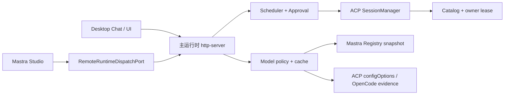

# P2 模型可用性、运行时与多 Session 边界设计

> 日期：2026-07-15
> 状态：用户已批准
> 范围：P2 方案设计；本轮不实施业务代码
> 关联：`docs/HANDOVER.md` P2 路线图与 ACP boundary hardening 剩余风险

## 1. 背景

当前项目已经具备 Router Session 级 ACP context 复用、Worker 实时事件、审批闭环和原子 catalog，但仍有六个 P2 缺口：

1. Leader 模型目录与 Mastra/models.dev 缺少稳定同步策略；
2. Worker 只有混合 health，模型缓存缺少完整 TTL 与 stale-while-revalidate 语义；
3. Provider env alias 主要依赖手工表；
4. OpenCode ACP 返回大体量 provider 宣告目录，默认 UI 无法表达“配置可用”；
5. Mastra Studio 的通用 `chatRoute` 缺少可信 Router Session tuple；
6. ACP catalog 没有跨进程所有权保护。

这里的“单写者”只约束操作系统进程，不约束业务并行。目标运行形态是：一个主运行时统一拥有 Scheduler、ACP SessionManager、审批和 catalog；多个 Router Session 与不同 reuse key 可在该运行时内并行，相同 reuse key 继续 FIFO。

## 2. 目标

1. Leader 模型事实来自已安装 Mastra registry，默认 UI 仍保持精选而非全量市场目录。
2. OpenCode 默认只返回配置上可用的短名单，同时保留本地按需搜索能力。
3. 模型发现、保存 pin 和实际 ACP 启动使用同一 eligibility 规则，不出现“可选但执行时被静默替换”。
4. CLI command、ACP capability 和模型目录新鲜度成为三个独立状态。
5. 模型缓存过期时可继续使用 last-known-good，并由 single-flight 后台刷新。
6. Provider env alias 主要从 Mastra registry 元数据派生，项目只维护小型例外表。
7. Studio 只有显式绑定现有 Router Session 后才能 dispatch，且 dispatch 进入主运行时。
8. 任一时刻最多一个进程拥有 writable ACP catalog 和 live session runtime。
9. 保持现有 Store 数据可读，不做破坏性迁移。

## 3. 非目标

- 不逐模型发起可能计费的真实推理调用来验证余额、限流或可用性。
- 不把 models.dev、OpenRouter 或 OpenCode 全量目录直接塞入 Leader prompt 或普通下拉框。
- 不让 Desktop 与 Studio 各自恢复和操作同一远端 ACP Session。
- 不建设跨主机、多用户的分布式锁或高可用控制面。
- 不在本阶段引入常驻 Router daemon；只保留未来可替换接口。
- 不自动为未绑定的 Studio thread 创建 Router Session。
- 不把 secret、内部 bearer token、agentSessionId 或原始 agent error 暴露给 UI/Leader。

## 4. 总体决策

采用“统一主运行时 + 分层模型策略”。不采用多进程各自运行再给 JSON 文件加临时锁，因为文件锁无法协调 live ACP session、Job、审批和 cancel。暂不采用独立 daemon，因为其启动、鉴权、事件和发布重构超出 P2 范围。



主运行时对外提供统一的 runtime port。Desktop 使用本地实现；Studio 使用 loopback client。未来若确需 daemon，只替换 port 实现，不改变 Leader tool、Scheduler 或模型策略契约。

## 5. Leader 模型目录

### 5.1 两层事实

Leader 模型目录分为：

- `RegistrySnapshot`：从当前安装版本的 Mastra `GatewayRegistry.getProviders()` 与 `getModels()` 读取 provider、model 和 `apiKeyEnvVar`。快照包含 Mastra package version、生成时间和来源。
- `FeaturedPolicy`：只保存产品精选的 provider/model、标签、排序和展示提示，不重复声明完整 provider 事实。

默认列表为 `RegistrySnapshot ∩ FeaturedPolicy`。当前已选择的 Leader model 即使不再位于精选层，也单独保留并标记为“当前选择、非精选”或“registry 未知”，不得静默改成默认模型。

### 5.2 更新与回退

- 普通应用启动和设置页只读取快照，不在请求路径在线同步。
- release/CI 的 `sync:model-registry` 维护命令使用当前安装的 Mastra registry 生成随应用发布的 versioned bundled snapshot；需要动态 `syncGateways()` 时也只在该维护进程运行，不能由打包后的应用写 `node_modules`。
- 可选的显式管理员刷新把成功结果原子写入 `~/.router-agents/mastra-model-registry.json`；失败继续使用上一个持久快照。
- 运行时来源优先级为：持久 last-known-good → bundled snapshot → 当前安装包的静态 registry。三者都不可用时设置页返回明确的 catalog error，不伪造空目录。
- 全量 registry 只用于搜索、模型 ID 校验和 env 元数据解析；Leader prompt 只接收当前模型和精选摘要。

## 6. OpenCode 配置可用短名单

### 6.1 可用性的产品定义

“可用”指配置证据满足执行前置条件，不等于已经完成逐模型付费调用。可靠证据包括：

- 模型存在于当前 ACP `configOptions` 候选集；
- Zen/free 模型位于项目 allowlist；或
- 直连 Provider 有本地凭据且未被 disabled；
- OpenRouter 有 Provider 凭据时，其模型可通过搜索选择，但不进入默认大列表。

Provider evidence 统一归一为：

```text
free | authenticated | disabled | unknown
```

`unknown` 不得展示为“可用”。自定义 Provider 只有在其运行所需配置能够安全、确定地投影到 sanitized ACP 环境时才能进入 `authenticated`；否则保持 `unknown`，允许诊断性手工输入，但不进入默认短名单。

### 6.2 单一 eligibility evaluator

新增概念边界 `ModelEligibilityEvaluator`，以下路径必须调用同一个 evaluator：

1. `refreshWorkerModels` 生成短名单；
2. `/api/workers/:id/model` 保存 pin；
3. `prepareOpenCodeAcpEnv` 选择 isolated config model；
4. Scheduler 执行前校验；
5. UI/Leader 生成可用性文案。

规则顺序：

1. 模型必须存在于 ACP 候选集；
2. Provider `disabled` 直接拒绝；
3. Zen/free allowlist 通过；
4. 直连 Provider `authenticated` 通过；
5. OpenRouter `authenticated` 只进入搜索结果，当前合法 pin 可回显到默认选择区；
6. 其余状态返回稳定 reason code，不进行模型名猜测。

一旦 evaluator 判定 pin 可用，isolated ACP 环境就必须按该模型启动；如果无法满足，保存 pin 或 dispatch 应明确失败，不能 remap 到 `opencode/big-pickle` 后继续并报告成功。现有 `OPENCODE_ALLOW_*` 只保留为诊断 override，不成为正常产品规则。

### 6.3 短名单与搜索索引分离

`WorkerRegistration.availableModels` 只保存默认短名单，供普通 Worker 下拉、Leader roster 与 snapshot 使用。完整候选保存在独立、版本化的 `WorkerModelCatalog`：

```ts
interface WorkerModelCatalog {
  version: 1
  workerId: string
  source: 'acp_config_options'
  fetchedAt: string
  expiresAt: string
  providers: Array<{
    providerId: string
    state: 'free' | 'authenticated' | 'disabled' | 'unknown'
  }>
  shortlist: WorkerModelOption[]
  searchIndex: WorkerModelOption[]
  lastErrorCode?: string
}
```

该结构不包含凭据，也不进入每次 app snapshot。所有 Worker catalog 统一保存到 versioned、原子替换的 `~/.router-agents/worker-model-catalogs.json`；单条 Worker 刷新必须以 workerId 为事务边界。API 语义为：

- `GET /api/workers/:id/models`：返回短名单与 freshness；
- `GET /api/workers/:id/models?q=...&limit=50`：搜索本地完整索引；
- `GET /api/workers/:id/models?force=1`：等待一次强制刷新。

disabled/unknown Provider 不出现在搜索结果。已认证 OpenRouter 可以被搜索，但响应要标明“Provider 配置可用，未做逐模型调用验证”。

## 7. Worker 三状态与缓存 TTL

### 7.1 状态分离

- `commandHealth`: `unknown | healthy | missing | unhealthy`，表示 CLI presence/version；默认 TTL 5 分钟。
- `acpHealth`: `unknown | ready | degraded | unavailable`，表示最近一次 ACP initialize/session/config/prompt 边界；默认 TTL 15 分钟，保留 `checkedAt`、`lastSuccessAt` 和安全 errorCode。
- `modelCatalogState`: `empty | fresh | stale`；默认 TTL 30 分钟。`refreshing` 只存在进程内，不持久化。

旧 `health` 暂时投影为 `commandHealth.status`。非强制派发跳过 fresh `missing/unhealthy`；fresh `acpHealth=unavailable` 也跳过。`degraded` 或过期 ACP 状态允许真实尝试，并以结果更新状态。

模型目录 stale 不阻断已有 pin。如果刷新明确确认 pin 的 Provider disabled 或无凭据，pin 保留但状态改为 unavailable，dispatch 在启动前返回可操作错误；不得清空选择或改用其他模型。

### 7.2 stale-while-revalidate

- fresh cache：直接返回；
- stale cache 且存在旧值：立即返回旧短名单并标 `stale=true`，后台刷新；
- empty cache：调用方等待首次刷新；
- `force=1`：调用方等待刷新结果；
- 同一 Worker 同时只有一个 in-flight refresh；
- 连续失败采用 30 秒、2 分钟、10 分钟退避，成功后清零；
- 失败保留 last-known-good、`lastSuccessfulFetchedAt` 与安全错误，禁止持久化原始 stack/agent payload。

## 8. Provider env 解析

新增概念边界 `ProviderEnvResolver`。它以 Mastra `ProviderConfig.apiKeyEnvVar` 的 string/string[] 为 canonical 来源，再叠加小型项目 override，仅覆盖 provider id alias、历史 env 名和自定义网关 base URL。

解析优先级：

1. Worker 显式 `worker.env`；
2. Settings 中当前 Provider 的加密 secret；
3. 当前进程已有 env；
4. 由同一已解析凭据派生的 canonical alias。

约束：

- 不覆盖更高优先级非空值；
- 不在无 registry/override 证据时把一个 Provider 的 key 复制给另一个 Provider；
- 自定义 Provider 默认只使用自身 `apiKeyEnv` 与 provider-scoped env；
- 解析诊断只能包含 env 名称和来源，不能包含值或 hash；
- 多个 OpenAI-compatible Provider 不共享一个可被最后写入者覆盖的全局 `OPENAI_BASE_URL`。自定义 base URL 优先通过 provider-scoped config/`OpenAICompatibleConfig` 传入；只有明确的 builtin provider 才允许 canonical global alias。

该 resolver 同时服务 Leader 模型鉴权检查、custom gateway 解析和 Worker spawn，避免三处维护不同 env 猜测规则。

## 9. 统一主运行时与 Mastra Studio

### 9.1 RuntimeDispatchPort

`dispatchWorkerTool` 依赖统一接口，而不是直接取某个进程的 Scheduler singleton：

```ts
interface RuntimeDispatchPort {
  resolveSessionContext(memoryThreadId: string): Promise<RouterSessionContext | null>
  dispatch(input: TrustedDispatchInput): Promise<WorkerJob>
  events(jobId: string, signal?: AbortSignal): AsyncIterable<WorkerRunEvent>
  cancel(jobId: string): Promise<void>
  resolveApproval(input: ResolveApprovalInput): Promise<void>
}
```

- `LocalRuntimeDispatchPort` 在主 http-server 内直接调用 Scheduler/EventEmitter。
- `RemoteRuntimeDispatchPort` 在 Studio 进程通过 loopback API 调用主运行时，将 SSE/NDJSON 事件还原成相同 AsyncIterable，并传播 abort/cancel。

Local/Remote 两个实现必须通过同一套 contract tests，保证 started/delta/approval/terminal 顺序、唯一终态和错误语义一致。

### 9.2 Studio RequestContext

已安装的 Mastra/AI SDK 支持 server middleware 写入 `RequestContext`，且 middleware 值优先于 `chatRoute` body。Studio 路径使用如下规则：

1. middleware 只提取 memory threadId，忽略请求体中的 Router Session/Project tuple；
2. 通过 RemoteRuntimeDispatchPort 向主运行时解析 thread；
3. 主运行时只在 threadId 精确匹配持久化 Router Session 的 `memoryThreadId` 时返回 trusted tuple；
4. middleware 写入 `routerSessionId/routerProjectId/memoryThreadId/routerProjectRoot`；
5. 无映射时普通聊天可继续，但 dispatch 返回 `ROUTER_SESSION_BINDING_REQUIRED`；不读取 global active Session，也不自动新建 Session。

主运行时只监听 `127.0.0.1`。每次启动生成随机 bearer token，并将 port、pid、startedAt 和 token 原子写入 mode 0600 的 `~/.router-agents/runtime.json`；重启轮换。日志、Activity 和 HTTP error 不得包含 token。

## 10. Catalog 生命周期所有权

主运行时初始化 writable catalog 前必须取得 `${ACP_CATALOG_PATH}.owner` 的独占生命周期 lease。lease 文件包含 pid、process start、owner token hash、createdAt 和 heartbeatAt。

规则：

1. owner lease 有效时，第二进程不得初始化本地 Scheduler/SessionManager/catalog writer，必须使用 RemoteRuntimeDispatchPort；
2. owner 的 PID + process-start identity 已失效且 heartbeat 超期时，竞争者先原子隔离旧 lease，再用 exclusive create 竞争新 lease；仅 PID 数字相同但进程启动时间不同也视为旧 owner 已失效；
3. 正常退出只有在 owner token 仍匹配时才删除 lease，防止旧进程误删新 owner；
4. crash 遗留 lease 可恢复，但不能仅凭时间在 PID 仍存活时抢占；
5. Studio 若要完全隔离实验，必须显式使用不同 `ACP_CATALOG_PATH`；
6. catalog 原有 strict schema、copy-on-write、fsync/rename 和 corruption sentinel 不变。

lease 解决的是“谁拥有整个 runtime”，不是把 catalog 变成多写者数据库。这同时避免两个进程分别恢复同一 agentSessionId。

## 11. 并行与背压

- 不同 Router Session/Worker reuse key 可以并行；当前默认由 `WORKER_MAX_GLOBAL=2` 和 `ACP_SESSION_POOL_MAX=8` 控制。
- 相同 reuse key 继续 FIFO，防止同一 ACP 上下文中的 prompt 交错。
- `WORKER_MAX_PER_WORKER` 控制每个 Worker 的 Job 并行度；提高它不会取消同 key FIFO。
- Desktop 与 Studio 的任务进入同一个 Scheduler，因此并发计数、审批、cancel、session reuse 和终态只有一份事实来源。
- 达到 pool/capacity 时维持现有有界排队与可取消语义，不通过启动第二 runtime 扩容。

## 12. 稳定错误与可观察性

模型侧公开错误：

- `MODEL_CATALOG_STALE`：有旧缓存，可继续并后台刷新；
- `MODEL_PROVIDER_UNAVAILABLE`：Provider disabled 或确认无凭据；
- `MODEL_SELECTION_UNVERIFIED`：自定义 Provider 证据不足；
- `MODEL_REFRESH_FAILED`：无缓存且刷新失败。

运行时侧公开错误：

- `RUNTIME_OWNER_EXISTS`：已有主运行时，本进程应使用 client；
- `ROUTER_RUNTIME_UNAVAILABLE`：主运行时不可达；
- `ROUTER_SESSION_BINDING_REQUIRED`：Studio thread 未绑定；
- `RUNTIME_AUTH_FAILED`：内部 token 无效。

UI、Leader 和 Activity 只消费稳定 code 与公开文案。内部日志允许记录阶段和 provider/worker ID，但不得记录 secret、token、agentSessionId、原始 ACP payload 或完整 env。

## 13. 兼容迁移

1. 新 health/catalog 字段先保持 optional；旧 snapshot 无需重写即可加载。
2. 旧 `health` 迁移为 `commandHealth.status` 的兼容输入与输出投影。
3. 旧 `availableModels` 在首次加载时视为 `legacy stale`；刷新成功后生成 v1 `WorkerModelCatalog`。
4. 旧 pin 永不自动清除。若新 evaluator 判定不可用，保留 pin 并显示 reason。
5. HTTP 返回在过渡期继续携带 `models/cached/stale`，再增量增加 catalog state 与 provider evidence summary。
6. Studio 在没有主运行时或绑定前只禁用 dispatch，不影响普通 Agent/Memory 调试。

## 14. 建议实施顺序

本设计不授权本轮实施。后续若进入实施，顺序固定为：

1. `RegistrySnapshot`、`ProviderEnvResolver`、`ModelEligibilityEvaluator` 及纯函数测试；
2. OpenCode 短名单、搜索索引、pin/执行一致校验；
3. command/ACP/model 三状态、TTL、SWR、single-flight 与迁移；
4. `RuntimeDispatchPort`、owner lease、runtime discovery/token；
5. Studio middleware、thread 映射、远端事件与 cancel；
6. UI/Leader 文案、集成测试和真实 E2E。

前三步优先解决用户可见的模型问题；后三步解决 Studio 和多进程所有权。每一步先写失败测试，再实现最小边界，避免一次性重构所有 server surface。

## 15. 验证矩阵

### 15.1 自动测试

- 模型 eligibility：free/authenticated/disabled/unknown、pin、OpenRouter、ACP 候选集的组合；发现与执行结果必须一致。
- Registry/env：精选交集、last-known-good、`apiKeyEnvVar` 数组、优先级和无跨 Provider key 泄漏。
- Cache：fake clock 覆盖 fresh/stale/empty、single-flight、退避、force refresh 和 legacy migration。
- Lease：两个 Node 进程竞争临时 catalog，只能一个 owner；覆盖 stale takeover、PID 活性和 token 误删保护。
- Runtime port：Local/Remote 对同一 dispatch 产生一致事件；abort、cancel、审批与终态一致。
- Studio context：映射 thread 注入可信 tuple；未映射和伪造 tuple 均被拒绝。
- 并行：不同 Router Session 的不同 key 真并行；相同 key FIFO；全局/Worker/pool 上限生效。

### 15.2 手工 E2E

1. Zen/free 模型默认出现并可执行；
2. 已认证直连 Provider 出现并按 pin 执行；
3. disabled/unknown Provider 不进入短名单；
4. 已认证 OpenRouter 通过搜索选择，默认列表不展开数百项；
5. stale cache 立即返回旧值，后台成功后 UI 更新；
6. Studio 使用已有 memory thread 绑定后可 dispatch、审批、cancel；未绑定时只收到明确错误；
7. 主运行时重启后 token 轮换、lease 接管和 catalog context 恢复正常；
8. 两个 Router Session 并行运行，不串 context，不产生第二 catalog owner。

## 16. 完成标准

六个 P2 项完成的判据如下：

| P2 项                  | 完成判据                                                          |
| ---------------------- | ----------------------------------------------------------------- |
| Leader/models.dev 同步 | RegistrySnapshot 与 FeaturedPolicy 分层，last-known-good 可回退   |
| Worker TTL/双健康      | command、ACP、model 三状态独立，SWR/退避/single-flight 有测试     |
| Provider env alias     | registry 自动派生为主，小型 override 为辅，无跨 Provider 泄漏     |
| OpenCode 可用模型      | 默认仅配置可用短名单，OpenRouter 按需搜索，pin 与执行不静默 remap |
| Mastra Studio context  | 仅已绑定 thread 注入 trusted tuple，dispatch 进入主 Scheduler     |
| Catalog 多进程保护     | 生命周期 owner lease 生效，第二进程只能 client 或使用隔离路径     |
