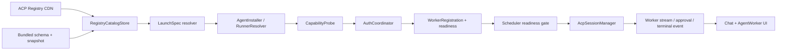

# ACP Registry 全量 Agent 接入设计

> 日期：2026-07-17
>
> 状态：设计已确认；本地实现与自动验证收尾中，Windows/Linux 原生打包和人工验收仍待执行
>
> 范围：调研、设计与规划；本阶段不修改业务代码

## 1. 背景与目标

Router Agents 当前以 Mastra 作为 Leader SDK，并通过项目自有的
`@agentclientprotocol/sdk@1.2.1` 客户端运行 Claude Code、Codex、OpenCode
等 Worker。ACP Registry 的推进使客户端可以通过统一清单发现、安装并配置更多
ACP Agent。

本设计的目标不是继续增加硬编码 preset，而是让当前 Registry 中、以及未来符合同一
schema major 的 Agent，都能在兼容平台上走统一的发现、准备、信任、认证、注册、
运行、升级和诊断流程。

“支持全部 Registry Agent”的产品定义为：

1. 能展示当前应用支持的 Registry schema 中全部合法条目与全部分发方式；
2. 能在当前平台解析并准备 `npx`、`uvx`、`binary` Agent；
3. 能处理 Registry 要求的 `agent`、`terminal` 认证，并兼容 SDK 已支持的
   `env_var` 认证；
4. 能通过本机 `initialize → authenticate（若需要）→ session/new` 证明 Agent
   可用，再允许 Leader 派发；
5. 能复用现有实时流、审批、取消、模型配置与 Session 上下文；
6. 对平台不支持、runner 缺失、协议不兼容、认证未完成、清单异常等情况给出明确状态，
   不把 Registry 收录等同于本机可运行；
7. 在已经定稿的 AgentWorker UI 中通过可搜索下拉框选择 Registry Agent，并在同一页面完成
   准备、认证和 readiness 操作，不另起一套页面结构。

## 2. 已确认的产品决策

| 决策项                  | 结论                                                                     |
| ----------------------- | ------------------------------------------------------------------------ |
| 接入深度                | 完整接入：发现、安装、认证、注册、运行、升级                             |
| 总体架构                | 在现有 ACP runtime 上增加 Registry 原生层，不引入第二套 launcher         |
| 无声明 sha256 的 binary | 用户显式确认后允许安装；固定首次实测摘要                                 |
| terminal auth           | 应用内受控终端                                                           |
| 安装与升级              | 用户显式触发；不在首次派发或后台静默执行第三方代码                       |
| 离线目录                | 持久 last-known-good + bundled snapshot                                  |
| schema 更新             | 只随软件升级；运行时不下载或热更新 schema                                |
| 上游 schema 偏差        | 随应用维护版本化兼容补丁；当前仅允许顶层 `extensions` 数组               |
| 新 Agent 默认角色       | 只授予 `general`；其他角色由用户显式增加                                 |
| OS 隔离                 | 维持可信本地 Agent 模型，显式信任并最小化进程输入；强沙箱另立项目        |
| UI 接入                 | 现有 UI 设计已经完成；以当前 AgentWorker 页面为基线适配，不重新设计页面  |
| Worker 选择             | 使用现有视觉体系内的可搜索下拉框，不改为卡片墙、常驻长列表或第二套选择器 |

## 3. 调研事实

### 3.1 官方协议与 Registry

ACP 本地 Agent 作为客户端子进程运行，通过 stdio 上的 JSON-RPC 通信；通知用于实时
流式更新，双向请求用于权限等交互。远程 HTTP/WebSocket Agent 仍在演进，不纳入本期
Registry 本地分发接入。

官方 Registry 是经过维护的 Agent 目录，清单包含自动安装所需的分发元数据。Registry
CI 会验证清单、分发 URL 和 `initialize.authMethods`，但 Registry 收录不等于每个版本
在 Router Agents 的每个平台、认证状态和能力组合下都可运行。

调研时（2026-07-17）远端清单为 schema `1.0.0`，共有 38 个 Agent：

- 21 个提供 `npx`；
- 2 个提供 `uvx`；
- 17 个提供 `binary`；
- 2 个同时提供 `npx + binary`；
- macOS arm64 的 17 个 binary 中只有 6 个声明 `sha256`。

当前官方 `registry.json` 顶层还包含 `extensions: []`，但同一 CDN/仓库发布的
`registry.schema.json` 使用 `additionalProperties:false` 且尚未声明 `extensions`。因此应用
需要随发布版本维护一个明确的 schema compatibility patch：当前只允许顶层 `extensions`
数组，并记录上游偏差；不能因此放开其他未知字段。

官方 2026-07-16 protocol adaptation matrix 探测 31 个 Agent，其中 30 个
`initialize` 成功，18 个在 `session/new` 返回 `auth_required`。能力覆盖也不一致：
`session/list`、`session/load`、`session/resume`、`session/fork` 并非全部实现。

参考资料：

- [ACP Introduction](https://agentclientprotocol.com/get-started/introduction)
- [ACP Architecture](https://agentclientprotocol.com/get-started/architecture)
- [ACP Registry](https://agentclientprotocol.com/get-started/registry)
- [ACP Registry RFD](https://agentclientprotocol.com/rfds/acp-agent-registry)
- [Registry repository](https://github.com/agentclientprotocol/registry)
- [TypeScript SDK v1.2.1](https://agentclientprotocol.github.io/typescript-sdk/)
- [Authentication Methods](https://agentclientprotocol.com/rfds/auth-methods)

### 3.2 项目已有能力

以下代码应保留并扩展：

| 现有能力                             | 入口                                                       |
| ------------------------------------ | ---------------------------------------------------------- |
| Registry URL、平台目标和启动模板解析 | `packages/adapters/src/acp-registry.ts`                    |
| Registry parser 单元测试             | `packages/adapters/src/acp-registry.test.ts`               |
| Owner 本地代理 API                   | `packages/mastra-app/src/http-server.ts`                   |
| Studio API 兼容路由                  | `packages/mastra-app/src/routes/api.ts`                    |
| Desktop catalog client               | `apps/desktop/src/lib/api.ts`                              |
| Registry 搜索与表单草稿              | `apps/desktop/src/lib/worker-registry.ts`                  |
| AgentWorker 下拉选择器               | `apps/desktop/src/components/WorkerRegistryCombobox.tsx`   |
| 已定稿 AgentWorker 主界面            | `apps/desktop/src/components/SettingsPanel.tsx`            |
| 通用 stdio ACP 驱动                  | `packages/adapters/src/acp-session-driver.ts`              |
| Session 复用与恢复                   | `packages/adapters/src/acp-session-manager.ts`             |
| 实时流、审批、调度                   | `packages/mastra-app/src/scheduler.ts`、`session-tools.ts` |

已有实现已经能在 UI 搜索 38 个条目并自动填入 `command/args/env`，但它只是目录表单
能力，不等于完整运行支持。

### 3.3 当前缺口

1. 未知 Registry Agent 被统一降为 `kind=custom`，Registry ID、版本、分发来源、许可证、
   仓库和 manifest digest 未持久化；
2. parser 固定按 `npx > uvx > binary` 选择单一分发，丢失其他候选；
3. binary 的 `archive`、`sha256` 和相对 `cmd` 被丢弃，只剩 PATH 上的 basename；
4. Registry 没有持久缓存或 bundled snapshot，单条异常会使整个目录失败；
5. runtime 忽略 `initialize.authMethods`，没有调用 `authenticate`，也没有 terminal auth；
6. Worker env 不能用于认证密钥，否则密钥会以明文进入 `state.json`；
7. `dispatchWorkerTool` 的描述仍硬编码三个 Agent；
8. 健康检查不能区分 runner、安装、initialize、认证、session ready 等阶段；
9. Registry 更新若直接覆盖 command，会破坏 Session execution fingerprint 边界；
10. 现有扁平 command/args 无法安全表达 terminal auth 中“runner 前缀不变、Agent 参数替换”。

## 4. 方案比较

### 4.1 方案 A：Registry 原生层（采用）

在当前 runtime 上增加 Catalog、LaunchSpec、Installer、AuthCoordinator、Probe，标准
Agent 走同一 ACP 状态机，少数有证据的差异由小型 override 表处理。

优点：完整复用实时流、审批、Session、Scheduler 和 Chat UI；兼容边界由项目掌控；
可以分阶段交付。

### 4.2 方案 B：外部 launcher sidecar

把 Agent 映射、安装和 Session 交给 acpx/OpenACP 等 CLI。

问题：形成第二套 Session、审批、取消、流式和错误模型；无法自然复用当前持久 catalog
与权限策略；外部工具也未承诺完整覆盖官方 Registry。

### 4.3 方案 C：逐 Agent adapter

为每个 Registry ID 生成 preset/adapter。

问题：Agent 数量和版本持续增长，维护成本与 Registry 的解耦目标冲突；应用发布周期会让
适配表快速陈旧。

## 5. 总体架构



Mastra 保持 Leader 与 tool 编排职责。Registry 接入位于 Worker runtime 边界，不把目录、
安装或认证逻辑放进 Leader prompt。

## 6. Catalog 与 schema

### 6.1 固定 schema

- 应用包内包含受支持的 `registry.schema.json`、`agent.schema.json` 和 bundled snapshot；
- schema 只在软件发布时更新；
- 应用包内还包含版本化 compatibility patch；当前只补充允许顶层 `extensions` 数组，
  Agent entry 与 distribution 仍按 bundled schema 严格校验；
- 远端 registry schema major 高于应用支持版本时，保留旧快照并返回
  `application_update_required`；
- 不动态下载 schema，不对未知结构做推测性转换。

### 6.2 来源优先级

1. 已校验的持久 last-known-good；
2. bundled snapshot；
3. 远端仅作为后台刷新候选。

打开 AgentWorker 页面时先返回本地目录，再使用 ETag/If-None-Match 刷新。远端请求失败
只把 catalog 标为 stale，不影响已安装 Agent。

### 6.3 容错

- 顶层版本、重复 ID 和整体结构失败：拒绝新快照；除 compatibility patch 明确允许的
  `extensions` 外，未知顶层字段仍拒绝；
- 单条 Agent 的当前平台分发异常：隔离该条并保留诊断，不清空其他 Agent；
- 未来可选字段原样保留在 raw metadata，但只有当前 schema 定义的字段进入执行层；
- `quarantine.json` 和 `.protocol-matrix` 没有稳定 CDN 契约，只用于开发/CI 参考；
  产品 runtime 不依赖它们。

## 7. 数据模型

### 7.1 Worker 来源

```ts
type WorkerSource =
  | { type: 'builtin' }
  | {
      type: 'registry'
      registryId: string
      registryVersion: string
      registrySchemaVersion: string
      manifestDigest: string
      distribution: 'npx' | 'uvx' | 'binary'
      target?: AcpRegistryTarget
      installationId: string
    }
  | { type: 'custom' }
```

`WorkerKind` 不扩成 38 个枚举。来源、品牌和运行时行为分开：

- `source`：谁管理安装与版本；
- `registryId`：品牌和目录身份；
- `runtimeProfile`：`generic-acp` 或少量已验证 override；
- `roles`：用户授权给 Leader 的路由能力。

### 7.2 结构化 LaunchSpec

```ts
interface WorkerLaunchSpec {
  distribution: 'npx' | 'uvx' | 'binary' | 'custom'
  runnerCommand?: string
  runnerArgs: string[]
  packageSpec?: string
  executable?: string
  agentArgs: string[]
  env: Record<string, string>
  artifact?: {
    archiveUrl: string
    declaredSha256?: string
    observedSha256?: string
    executableRelativePath: string
  }
}
```

`command/args` 暂时保留为 materialized execution projection，兼容旧 Store、Scheduler 和
手工 custom Worker。Registry Worker 的投影只能由 Owner 从受信 catalog/installation
生成，客户端不能自行提交 command 并声称它来自 Registry。

### 7.3 安装状态

安装事实单独保存在 `~/.router-agents/acp-agent-installations.json`，包含：

- registry ID、版本、target、distribution；
- manifest digest、archive URL、声明与实测摘要；
- 安装目录、resolved executable、runner 版本；
- installedAt、lastProbedAt、probe result；
- 被哪些 Worker 或 persisted Session 引用。

Worker/state 只持有 installation 引用与非敏感 readiness/auth revision。

## 8. 安装与升级

### 8.1 binary

安装目录：

```text
~/.router-agents/agents/<registryId>/<version>/<target>/
```

流程：

1. 以 registry ID、version、distribution、manifest digest 生成确认页；
2. 在同一数据目录创建 staging；
3. HTTPS 下载，限制重定向、响应体大小、超时和允许的 archive 格式；
4. 计算 SHA-256；有声明时必须匹配；无声明时校验用户的显式 trust decision；
5. 安全解压，拒绝绝对路径、`..`、越界 symlink/hardlink、特殊设备文件和解压炸弹；
6. 确认清单 `cmd` 位于 staging 内并具有可执行权限；
7. 用隔离 cwd/HOME 做 initialize 探测；
8. 成功后原子 rename 为不可变版本目录并写 installation manifest。

无声明 sha 的同版本内容如果 observed digest 改变，必须阻断并要求重新确认，不能以“同一
版本”静默替换。

### 8.2 npx / uvx

- 使用 Registry 清单中的精确 package spec，不转换成 `latest`；
- Node/npm 或 uv 是 runner prerequisite；先解析绝对 runner 路径和版本；
- 缺失时返回 `missing_runner` 和安装指引；
- 用户显式“准备”时才下载/执行 package 生命周期脚本和 initialize 探测；
- runner 前缀与 Agent ACP 参数分离，以便 terminal auth 只替换 Agent 参数。

### 8.3 升级与清理

- Catalog 刷新只产生 `update_available`；
- 新版本安装和探测成功后，再原子更新 Worker launch projection；
- installation/version/auth revision 进入 execution fingerprint，切换后旧 live Session 不复用；
- 旧版本被 live 或 persisted Session 引用时不删除；
- 清理操作必须显式、可诊断且不删除 Agent 自己的认证目录。

## 9. 信任与权限边界

安装前确认页至少展示：

- Agent 名称、Registry ID、版本、作者、许可证、仓库/网站；
- distribution、package spec 或下载域名、最终执行命令；
- declared/observed digest 状态；
- 是否需要 runner、网络和认证；
- “该 Agent 是以当前 OS 用户运行的本地进程，不是 OS 强沙箱”。

继续保留现有边界：

- 子进程环境变量最小化；
- Router 内部 token、Desktop token、Studio token 永不下传；
- 客户端 fs read/write 只能访问项目根；
- ACP tool call 继续走 Session 级审批策略；
- Registry icon 不直接作为可执行 SVG 注入 DOM，需受限代理/缓存或通用图标降级。

本期不承诺阻止受信本地进程以 OS 用户权限直接访问其他文件。跨平台强沙箱或容器运行是
独立项目。

## 10. 认证与 readiness

### 10.1 状态机

```text
cataloged
  -> preparing
  -> prepared
  -> initializing
  -> auth_required
  -> authenticating
  -> ready | degraded | incompatible | failed
```

每个状态都携带稳定 code、公共文案、可执行下一步和最近探测时间。

### 10.2 initialize 与 auth_required

- 初始化发送项目真实支持的 client capabilities 和 clientInfo；
- 不支持的 protocolVersion 立即断开并标记 incompatible；
- 保存经过清洗的 agentInfo、agentCapabilities、authMethods；
- 尝试 `session/new`，仅按 `RequestError.code=-32000` 且
  `data.reason=auth_required` 进入认证状态，不匹配错误字符串；
- 认证成功后必须再次 `session/new` 验证，不能只凭 authenticate RPC 成功标 ready。

### 10.3 Agent Auth

在 setup connection 上调用 `authenticate({ methodId })`，Agent 自行打开浏览器、运行本机
OAuth callback 并保存凭证。完成后验证 session/new，再释放 setup 进程。

### 10.4 Terminal Auth

- 只有内嵌 PTY 可用时才声明 `clientCapabilities.auth.terminal=true`；
- Owner 根据 worker/installation/auth method 生成固定命令；Renderer 不能传 command；
- 创建短时一次性 auth attempt 和 WebSocket token；
- token 通过 `Sec-WebSocket-Protocol` 传递，不放 URL/query、日志或持久状态；
- WebSocket 只接收 input、resize、cancel，限制输出、时长、并发和重放；
- terminal auth 完成后重新 initialize/session-new；
- 日志和持久状态不保存终端输入。

### 10.5 Env Var Auth

Registry 当前最低要求是 agent 或 terminal，但 SDK 已定义 env_var：

- 密钥以 `(workerId, envName)` 存入加密 secret namespace；
- `state.json`、Worker.env、Activity、Job、错误文本不出现明文；
- 只注入目标 Worker；不得因为变量同名而写入 Leader 或其他 Worker；
- secret revision 以 HMAC/版本号进入 execution fingerprint，不暴露值。

### 10.6 Logout 与账号变化

仅在 Agent 宣告 `agentCapabilities.auth.logout` 时调用 logout。成功认证、logout、密钥变化
都递增 `authRevision`，清理该 Worker 的 live context，并使持久 catalog 的旧 execution
fingerprint 不再命中。

## 11. ACP 能力协商

- 只声明真正实现的客户端能力；
- `load/resume/close/delete` 仅在 Agent 宣告后调用；
- 没有恢复能力的 Agent 可以复用 live Session，但进程丢失后明确要求重置上下文；
- model、mode、reasoning 等统一来自 session configOptions，不假定每个 Agent 都提供模型；
- `session/update` 归一化 agent message、thought、tool call、plan、usage、config、session info；
- UI 未实现的已知事件类型可以安全忽略并记诊断，但不能抛出导致流中断；
- `end_turn` 成功；`cancelled`、`refusal`、`max_tokens`、`max_turn_requests` 分别返回稳定状态；
- 未声明的实验性 terminal RPC、elicitation、provider API 不纳入本期“全部 Registry Agent”
  承诺。

## 12. Scheduler、Session 与 Mastra

Mastra 不需要更换，也不负责 Registry：

- `listWorkersTool` 返回动态 worker ID/name、角色与 readiness；
- `dispatchWorkerTool` 删除 Claude/Codex/OpenCode 的硬编码提示；
- Scheduler 在创建 Job 前执行 readiness gate；
- `WORKER_AUTH_REQUIRED` 在 Chat/Worker 卡片显示 Agent 身份和“去认证”动作；
- 派发不会悬挂等待 OAuth/terminal，也不会把认证冒充 tool approval；
- `AcpSessionManager` 继续作为唯一 Session owner；
- launch spec、installation、auth revision、runtime profile、model/env evidence 都进入 reuse
  fingerprint，避免跨 Agent、版本、账号或配置串上下文。

## 13. API 设计

### 13.1 Catalog

`GET /api/workers/registry` 保持向后兼容，同时增加：

- schemaVersion、snapshotVersion、source、fetchedAt、stale、updateRequired；
- Agent 完整 metadata 与全部 distributions；
- 当前平台、runner、install、trust、probe、auth、readiness 状态；
- 旧 UI 使用的默认扁平 command/args 投影（过渡期）。

### 13.2 安装与 Worker

实现端点：

- `POST /api/workers/registry/prepare`（`202` operation）
- `GET/DELETE /api/workers/registry/operations/:operationId`
- `POST /api/workers/registry/register`
- `POST /api/workers/:id/upgrade`
- `DELETE /api/workers/registry/installations/:installationId`
- `POST /api/workers/:id/probe`

Registry 写请求必须提交 manifest digest 与 trust decision，Owner 对照当前受信快照解析，拒绝
客户端 command/args 注入。

### 13.3 认证

实现端点：

- `GET /api/workers/:id/auth-methods`
- `POST /api/workers/:id/authenticate`（`202` operation）
- `POST /api/workers/:id/auth-terminal`
- `GET /api/workers/:id/auth-terminal/:attemptId`（状态）
- `WS /api/workers/:id/auth-terminal/:attemptId/ws`
- `POST /api/workers/:id/logout`

terminal token 一次性、短时、绑定 worker/attempt/Desktop capability，通过
`Sec-WebSocket-Protocol` 传递；沿用 Desktop token 与 Origin allowlist。

## 14. 已定稿 UI 的适配边界

当前 AgentWorker UI 设计已经完成，`SettingsPanel.tsx` 中的 `settings-workers`、已注册 Worker
列表、注册卡片和 `WorkerRegistryCombobox` 是本需求的界面基线。实现 Registry 全量接入时只做
能力适配，不重新规划信息架构，也不在 `RightPanel` 复制一套 Registry 管理入口。

Registry Agent 的主选择控件必须是可搜索下拉框：关闭时只占一个表单字段，打开时在下拉层中
展示匹配项；不得改成卡片墙、页面内常驻 38 项长列表或另一个 modal picker。下拉框沿用当前
键盘导航和 combobox ARIA 语义，并增加平台可用性、分发、安装、认证和 readiness 摘要。选择
Agent 后，详情、准备进度和认证动作在现有注册卡片内的下拉框下方展开。

先完成共享类型和 Owner API，再将以下能力组件薄接到现有页面，避免重写大型
`SettingsPanel.tsx`：

- `useAcpRegistryCatalog`
- `RegistryAgentDetail`
- `WorkerPrepareProgress`
- `WorkerAuthTerminalModal`
- `WorkerReadinessBadge`

目录 UI 展示平台、分发、许可证、摘要、runner、安装、升级、认证和 readiness。Chat 中的
auth CTA 复用 Worker identity，不复制审批逻辑。`RightPanel` 继续承担运行态概览；若要显示
readiness，只复用 badge/动作，不承载安装表单。

已有 Claude/Codex/OpenCode Worker 迁移为 `source=builtin`，ID、命令、Session 和角色保持不变。
只有用户主动选择“采用 Registry 管理”时才切换到精确 Registry 安装。

## 15. 错误模型与可观测性

稳定错误码至少包括：

- `ACP_REGISTRY_UNAVAILABLE`
- `ACP_REGISTRY_SCHEMA_UNSUPPORTED`
- `ACP_REGISTRY_ENTRY_INVALID`
- `ACP_PLATFORM_UNSUPPORTED`
- `ACP_RUNNER_MISSING`
- `ACP_INSTALL_TRUST_REQUIRED`
- `ACP_INSTALL_DIGEST_MISMATCH`
- `ACP_INSTALL_ARCHIVE_UNSAFE`
- `ACP_INSTALL_FAILED`
- `ACP_PROTOCOL_INCOMPATIBLE`
- `WORKER_AUTH_REQUIRED`
- `WORKER_AUTH_FAILED`
- `WORKER_NOT_READY`

Activity 只记录非敏感摘要：registry ID、版本、阶段、耗时、code、distribution、target；不记
密钥、终端输入、OAuth code、完整 stderr 或用户目录细节。

## 16. 分阶段交付

1. Catalog v2、pinned schema、LKG/bundled snapshot、source/launchSpec；
2. installer、immutable version store、trust/digest/runner readiness；
3. initialize/capability/auth state machine、worker-scoped secret、fingerprint；
4. PTY WebSocket、独立 UI、Chat auth CTA；
5. 迁移、升级/清理、打包、文档、真实兼容 smoke。

每阶段保留手工 custom Worker；Registry install 和 terminal auth 可分别用功能开关禁用，不影响
已有 Worker 与 Session。

## 17. 验收策略

### 17.1 自动测试

- 真实 Registry 只做 fetch/parse/schema contract，不在普通测试执行第三方代码；
- parser 覆盖全部分发、平台、多分发、未知 schema、单条隔离和 LKG；
- installer 使用本地 fixture 覆盖路径穿越、symlink/hardlink、解压炸弹、重定向、大小限制、
  sha 缺失/匹配/不匹配、并发和原子回滚；
- fake ACP Agent 覆盖 agent/terminal/env_var auth、auth_required、capability 差异、stopReason、
  stream、approval、cancel、Session reuse 与 authRevision；
- API 覆盖 trust digest TOCTOU、Desktop token、Origin、一次性 terminal token、日志脱敏；
- Store migration 保证已有 Worker ID/Session 不变；
- typecheck、全测、build、runtime bundle/load、release contract 和 packaged smoke 全部通过。

### 17.2 打包与手工验收

- macOS、Windows、Linux 分别验证 npx、uvx、binary 代表路径；
- 验证 PTY 原生依赖在安装包中可加载；
- 验证 Agent OAuth、terminal auth、logout/re-auth；
- 验证 Chat auth CTA、安装确认、升级、离线 snapshot、schema update required；
- 验证同 Worker 同 Router Session 复用，不同版本/账号绝不复用；
- 提供显式 opt-in 的真实 Registry compatibility smoke，使用隔离 HOME/data/cwd，默认 CI
  和 `npm test` 不下载执行第三方 Agent。

## 18. 非目标

- 远程 HTTP/WebSocket ACP Agent；
- 为每个 Registry Agent 编写专有 adapter；
- 自动从描述推断角色；
- 后台静默安装或升级；
- 运行时热更新 Registry schema；
- 宣称第三方 Agent 运行在 OS 强沙箱；
- 本期实现所有实验性 ACP extension；
- 改写已经定稿的 AgentWorker 信息架构，或新增与现有下拉框竞争的 Registry 选择入口。
